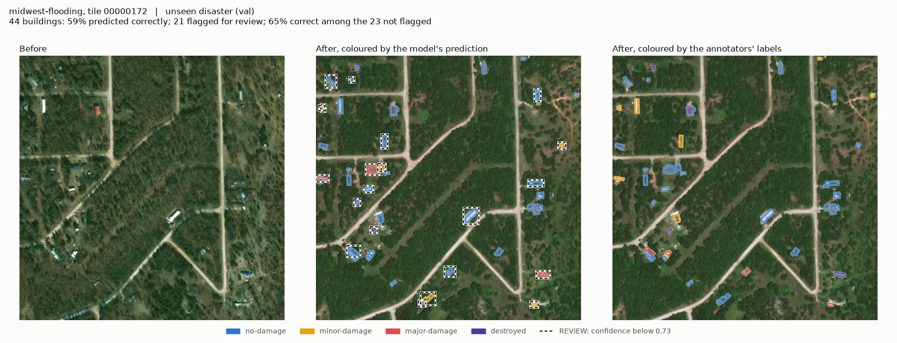
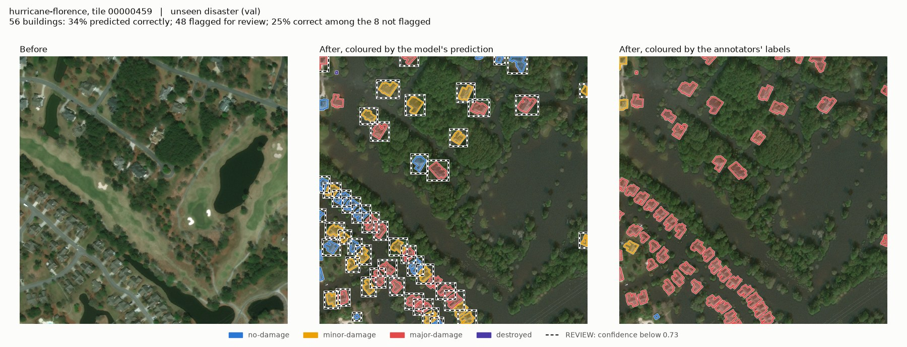

# damage-triage

Building damage assessment on the xBD dataset, with a review queue: classify each
building as no-damage / minor / major / destroyed from a before and an after satellite
image, and decide which buildings a person should look at.

**Every number here is from validation data. The test set (hurricane-michael,
santa-rosa-wildfire) has never been loaded or evaluated;** the code refuses to load it
without `--final` (`src/split.py`).

Current state in one page: [PROJECT_STATE.md](PROJECT_STATE.md).

## The two validation sets

- **val-tiles**: 14,718 buildings on held-out tiles of the six *training* disasters.
  "The same kind of disaster the model has seen."
- **val**: 19,099 buildings from two flood disasters the model never trained on
  (hurricane-florence, midwest-flooding). "A new disaster."

Caveat that applies to every val number: **val helped choose each model's checkpoint**
(the kept epoch maximises the mean of the val-tiles and val macro-F1, averaged over 3
epochs), and settings were compared on val. val is therefore somewhat optimistic as an
estimate for a truly new disaster.

## Headline result: a review queue for buildings called "no-damage"

The model is an ensemble of three ResNet-18 models (pre and post image stacked into 6
channels, strong augmentation, seeds 0-2). A person can review a share of the
buildings. The queue that works best: **review only buildings the model predicts as
no-damage, the most doubtful first** (highest 1 - P(no-damage)); buildings predicted
damaged go straight to the damage map.

*Miss rate* = of all truly damaged buildings, the share that nobody reviews and the
model calls no-damage. Brackets: 95% intervals from 1000 bootstrap resamples of whole
tiles.

Reviewing 20% of the buildings:

| who is reviewed | val-tiles miss rate | val miss rate |
|---|---|---|
| nobody | 0.163 (0.120-0.204) | 0.374 (0.342-0.405) |
| 20% at random | 0.130 | 0.299 |
| 20%: predicted no-damage, in random order | 0.121 | 0.257 |
| 20%: least confident first | 0.059 (0.036-0.089) | 0.283 (0.251-0.313) |
| **20%: predicted no-damage, most doubtful first** | **0.022 (0.010-0.042)** | **0.185 (0.158-0.214)** |


(Left panel val-tiles, right panel val.) Full analysis, other review rates and the
accuracy plots: [docs/risk_coverage.md](docs/risk_coverage.md).

What that buys, and what it costs:

- On val it halves the missed damage at a 20% review rate. 18.5% of damaged buildings
  are still missed.
- The damage map is not checked. On val-tiles 73% of the buildings predicted damaged
  are truly damaged; **on val only 21% are** (6,825 predicted, about 5,400 false
  alarms). Whether that trade is acceptable depends on what a false alarm costs.
- Reviewing by plain confidence, the usual recipe, barely beats random review on val
  (0.283 against 0.299).

## Same disaster against unseen disaster

| ensemble of 3 | val-tiles | val |
|---|---|---|
| accuracy | 0.876 | 0.640 |
| macro-F1 | 0.705 | 0.313 |
| always answering "no-damage": accuracy | 0.809 | 0.878 |
| share of damaged buildings called no-damage | 0.163 | 0.374 |
| calibration error (ECE) after temperature scaling | 0.010 | 0.030 |

**The model does not transfer to a new disaster.** On val it is less accurate than
always answering "no-damage", and it finds about 20% of the minor-damage and destroyed
buildings. What does carry over is honesty about its own doubt: its confidence falls
about as much as its accuracy, and a temperature fitted on val-tiles (1.215) is as good
on val as one fitted on val itself (1.232)
([docs/calibration_results.md](docs/calibration_results.md)). Single models: val
accuracy 0.604-0.641 over three seeds; the ensemble mainly removes that luck of the
seed ([docs/uncertainty_plan.md](docs/uncertainty_plan.md)).

Unseen-disaster tiles from the single base model (seed 0). Both are **val**. REVIEW
marks buildings below the confidence threshold. More:
[docs/demo_val.md](docs/demo_val.md).





## What was tried against the val gap, and did not work

Each with seeds 0, 1, 2 under the same selection rule; mean over seeds. None is better
than the base on val.

| setting | val-tiles macro-F1 | val accuracy | val macro-F1 | verdict |
|---|---|---|---|---|
| base (stack ResNet-18, strong augmentation) | 0.694 | 0.617 | 0.304 | model of record |
| + histogram matching (post recoloured to pre) | 0.672 | 0.571 | 0.271 | rejected |
| + per-image normalisation | 0.681 | 0.497 | 0.248 | rejected |
| + same-image training pairs | 0.688 | 0.554 | 0.274 | rejected (stop rule) |
| siamese with a difference-only head | 0.695 | 0.537 | 0.268 | rejected (stop rule) |

- The two colour fixes tested whether overall colour explains the gap. It does not.
- The two pre-image fixes tested whether forcing the model to compare before and after
  helps. Their keep/drop rule was written and committed before training
  ([docs/pre_image_plan.md](docs/pre_image_plan.md)): keep only if val macro-F1 rises
  by 0.03 without val accuracy falling. Both lowered val macro-F1 by about 0.03.
- MC dropout as an uncertainty signal: indistinguishable from plain softmax, because
  dropout sits only before the last layer. Set aside.
- Why val is worse, as far as it is understood:
  [docs/gap_diagnosis.md](docs/gap_diagnosis.md). The cause is not established.

All settings, with spread over seeds: [docs/results.md](docs/results.md).

## Layout

- `src/`: library code. `labels.py`, `split.py` (split + test-set guard), `crops.py`,
  `dataset.py`, `model.py`, `model_diff.py`, `train.py`, `metrics.py`, `calibrate.py`,
  `uncertainty.py`, `triage.py`
- `scripts/`: `build_crops.py`, `export_predictions.py`, `make_results.py`,
  `gap_diagnosis.py`, `calibrate_ensemble.py`, `risk_coverage.py`, `error_analysis.py`,
  `demo_figures.py`, `pre_image_use.py`, `stop_rule.py`, `candidate_report.py`, plus the
  data-exploration scripts
- `configs/`: training configs
- `splits/split_v1.csv`: the split (source of truth)
- `docs/`: start with [WALKTHROUGH.md](docs/WALKTHROUGH.md) (study guide to the modelling
  code). Data: [observations](docs/observations.md), [data quality](docs/data_quality.md),
  [data decisions](docs/data_decisions.md), [split](docs/split_final.md) and
  [why](docs/split_decision.md). Model: [results](docs/results.md),
  [gap diagnosis](docs/gap_diagnosis.md), [uncertainty plan](docs/uncertainty_plan.md),
  [calibration](docs/calibration_results.md), [risk-coverage](docs/risk_coverage.md),
  [pre-image experiments](docs/pre_image_plan.md), [error analysis](docs/error_analysis.md)
- `runs/`: checkpoints, logs and predictions (not in git)
- `outputs/`: generated artifacts (not in git, except `outputs/demo/`)
- `tests/`: test suite (synthetic data; no dataset or GPU needed)
- Data: the xBD Challenge set from [xview2.org](https://xview2.org), stored outside the
  repo, as is the crop cache built from it

## Reproduce

```powershell
$py = ".\.venv\Scripts\python.exe"
$data = "C:\Users\wikel\dev\xbd-data"

# 1. crop cache (train, val-tiles, val; never test)
& $py scripts\build_crops.py --data-dir $data

# 2. the base model, three seeds
foreach ($s in 0, 1, 2) { & $py -m src.train --config configs\stack_aug.json --seed $s --num-workers 6 }

# 3. per-building predictions of the three seeds (train, val-tiles, val)
& $py scripts\export_predictions.py

# 4. reports
& $py scripts\make_results.py                 # docs/results.md
& $py scripts\gap_diagnosis.py --runs runs\stack_aug_s0 runs\stack_aug_s1 runs\stack_aug_s2
& $py scripts\calibrate_ensemble.py           # docs/calibration_results.md
& $py scripts\risk_coverage.py                # docs/risk_coverage.md (the headline table)
& $py scripts\error_analysis.py --run runs\stack_aug_s0 --data-dir $data
& $py scripts\demo_figures.py --run runs\stack_aug_s0 --data-dir $data --parts val --per-disaster 3 --out-dir docs\figures --prefix demo_val_ --doc docs\demo_val.md
```

The rejected settings, if you want to re-measure them (3 seeds each, then
`make_results.py` again):

```powershell
foreach ($c in "stack_aug_histmatch", "stack_aug_pernorm", "stack_aug_samepair", "siamese_diff_aug") {
    foreach ($s in 0, 1, 2) { & $py -m src.train --config configs\$c.json --seed $s --num-workers 6 }
}
& $py scripts\pre_image_use.py --settings stack_aug stack_aug_samepair siamese_diff_aug
& $py scripts\stop_rule.py --candidate stack_aug_samepair
& $py scripts\stop_rule.py --candidate siamese_diff_aug
```

On an 8 GB laptop GPU with 6 loader workers: about 15 minutes and 17.5 GB of RAM per
stack run (GPU peak 4.1 GB), about 22 minutes and 20.5 GB per siamese run (GPU peak
6.8 GB). None of these commands touches the test set.

## Setup

See `SETUP_NOTES.md` for environment setup details.
