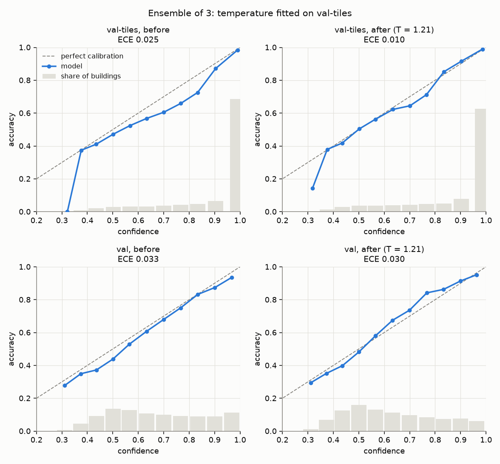
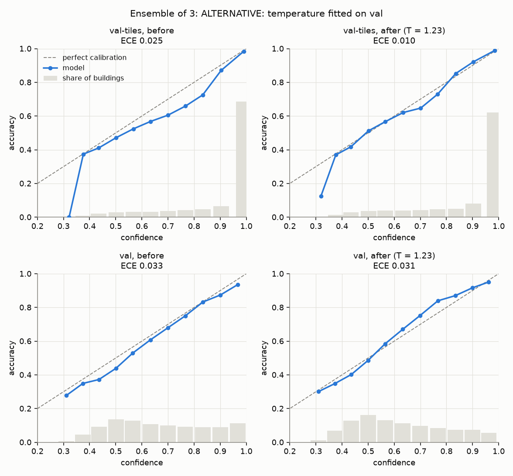
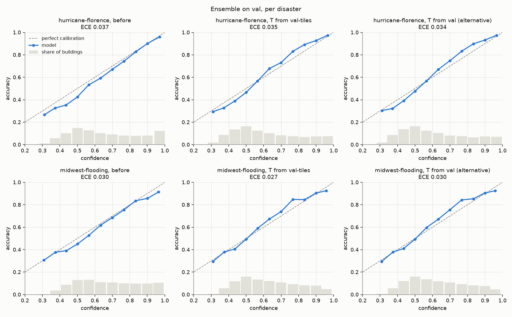

# Calibration of the ensemble (validation only)

Written 2026-10-09. The model here is the ensemble of the three base seeds
(`stack_aug_s0..2`): for each building the three seeds' probabilities are averaged.
Everything is computed from the exported predictions in `outputs/predictions/`, parts
val-tiles and val. **The test set was not touched**; no model or image is loaded at all.

The text in this first part is written by hand. The tables below it are generated by
`scripts/calibrate_ensemble.py`; if they are regenerated from different predictions,
this reading has to be checked against them again.

## What was asked

"Calibrated" means the stated confidence can be taken at face value: of all buildings
where the ensemble says 80%, about 80% are right. Two numbers measure it:

- **ECE** (expected calibration error): the average gap between confidence and
  accuracy. 0 is perfect; 0.03 means off by three percentage points on average.
- **NLL** (negative log-likelihood): punishes being confidently wrong. Lower is better.
  Unlike ECE it also gets worse when the model is simply wrong more often, so it cannot
  be compared between val-tiles and val as a measure of calibration alone.

Temperature scaling divides the logits by one number T before the softmax. T above 1
makes every prediction less sure. It never changes which class is predicted.

## Reading

**1. On val-tiles, temperature scaling works.** The fitted temperature is 1.215: the
ensemble was a little too sure of itself. Scaling brings ECE from 0.025 to 0.010 and
NLL from 0.335 to 0.328. After scaling, confidence (0.878) and accuracy (0.876) agree.

**2. On val, the ensemble is already close to calibrated on average, and scaling
changes little.** ECE goes from 0.033 to 0.030, NLL from 0.872 to 0.861. Mean
confidence was 0.673 against an accuracy of 0.640 before, and is 0.630 after. So the
ensemble *does* register that val is harder: its confidence drops by about as much as
its accuracy does. That is the good news in this document.

**3. Fitting the temperature on val itself gives nearly the same temperature: 1.232
against 1.215.** NLL on val is the same to four decimals (0.8608), and ECE is even
slightly higher (0.031 against 0.030), which can happen because the fit minimises NLL,
not ECE. In plain terms: the temperature learned on the training disasters is as good
for val as one tuned on val with its labels. Nothing was lost by not having a new
disaster's labels, at least for these two disasters.

**4. What one temperature cannot fix on val is the shape.** In the reliability diagram
for val after scaling, predictions below about 0.5 confidence are a little
over-confident and predictions between about 0.6 and 0.9 are under-confident (accuracy
is above the diagonal). One number can only make all predictions surer or all less
sure; it cannot push the two ends in opposite directions. This is why ECE on val barely
moves.

**5. The two val disasters look alike.** After scaling with the val-tiles temperature,
ECE is 0.035 on hurricane-florence and 0.027 on midwest-flooding, with accuracy 0.624
and 0.652. Neither is singled out by a calibration problem. They fail for different
reasons (`docs/gap_diagnosis.md`), but their confidence is about equally honest.

**6. Good calibration is not good accuracy, and the per-class table shows the real
problem.** On val the ensemble finds 68% of the undamaged buildings, 40% of the
major-damage ones, and only about 20% of the minor-damage and destroyed ones. Two
things to keep in mind when reading that table:

- minor-damage and destroyed have few buildings on val (372 and 187), so their
  percentages are rough, and per disaster rougher still (64 destroyed buildings in
  florence);
- the two disasters differ a lot on major-damage: 37% found in florence (1,626
  buildings) against 71% in midwest-flooding (144 buildings).

Most missed damage is called no-damage: 63% of the minor-damage and 33% of the
major-damage buildings on val. For a triage tool that is the costly direction of error.

**7. What "calibrated" does and does not promise here.** ECE as computed here looks
only at the top class and averages over all buildings. A low ECE on val says: "when the
ensemble is 70% sure, it is right about 70% of the time, taken over everything". It
does not say that the probability it gives to *minor-damage* specifically is
trustworthy, and with 20% accuracy on that class there is no reason to assume so. The
ensemble is honest about being unsure on val; it is not good on val.

## What this means for the next step

- Use T = 1.215, fitted on val-tiles, for the ensemble. There is no case for a
  val-fitted temperature: it is the same number, and it would use val's labels.
- Confidence thresholds for triage can be chosen on the scaled probabilities with some
  trust that they mean roughly the same on a flood disaster as on the training
  disasters. Two disasters are thin evidence for that; both are floods.
- Calibration is not where the val problem is. The accuracy per class is.

<!-- section:tables:start -->
## Tables

Generated by `scripts/calibrate_ensemble.py` from `outputs/predictions/` (runs: `stack_aug_s0`, `stack_aug_s1`, `stack_aug_s2`; mean softmax over the seeds). val-tiles: 14,718 buildings; val: 19,099. ECE uses 15 equal-width confidence bins. NLL = mean of -log(probability given to the true class). Temperature scaling never changes the predicted class, so accuracy is the same before and after.

### 1. Temperature fitted on val-tiles (T = 1.215), applied to both parts

| part | temperature scaling | ECE | NLL | mean confidence | accuracy |
|---|---|---|---|---|---|
| val-tiles | before | 0.0246 | 0.3353 | 0.9005 | 0.8759 |
| val-tiles | after | 0.0101 | 0.3284 | 0.8777 | 0.8759 |
| val | before | 0.0327 | 0.8718 | 0.6726 | 0.6398 |
| val | after | 0.0297 | 0.8608 | 0.6301 | 0.6398 |

### 2. Alternative: temperature fitted on val (T = 1.232)

**Not the main result.** Here the temperature is fitted on the same val buildings it is then scored on, which needs val's true labels. The val rows are therefore the best any single temperature can do on val, not what would happen on a new disaster.

| part | temperature scaling | ECE | NLL | mean confidence | accuracy |
|---|---|---|---|---|---|
| val-tiles | before | 0.0246 | 0.3353 | 0.9005 | 0.8759 |
| val-tiles | after | 0.0104 | 0.3284 | 0.8758 | 0.8759 |
| val | before | 0.0327 | 0.8718 | 0.6726 | 0.6398 |
| val | after | 0.0309 | 0.8608 | 0.6269 | 0.6398 |

### 3a. ECE per disaster on val

| disaster | buildings | accuracy | mean confidence, before | mean confidence, T from val-tiles | mean confidence, T from val (alternative) | ECE, before | ECE, T from val-tiles | ECE, T from val (alternative) |
|---|---|---|---|---|---|---|---|---|
| all | 19,099 | 0.6398 | 0.6726 | 0.6301 | 0.6269 | 0.0327 | 0.0297 | 0.0309 |
| hurricane-florence | 8,237 | 0.6241 | 0.6616 | 0.6214 | 0.6185 | 0.0375 | 0.0346 | 0.0344 |
| midwest-flooding | 10,862 | 0.6517 | 0.6809 | 0.6366 | 0.6333 | 0.0297 | 0.0275 | 0.0298 |

### 3b. Accuracy per true class

Of the buildings that truly belong to a class, the share the ensemble assigned to it (the class's recall). The same at every temperature.

| buildings | true class | n | accuracy | most common wrong answer |
|---|---|---|---|---|
| val-tiles (all) | no-damage | 11,910 | 0.925 | minor-damage (4% of the class) |
| val-tiles (all) | minor-damage | 888 | 0.492 | no-damage (25% of the class) |
| val-tiles (all) | major-damage | 1,205 | 0.757 | no-damage (15% of the class) |
| val-tiles (all) | destroyed | 715 | 0.734 | major-damage (12% of the class) |
| val (all) | no-damage | 16,770 | 0.680 | minor-damage (18% of the class) |
| val (all) | minor-damage | 372 | 0.204 | no-damage (63% of the class) |
| val (all) | major-damage | 1,770 | 0.397 | no-damage (33% of the class) |
| val (all) | destroyed | 187 | 0.209 | major-damage (41% of the class) |
| val: hurricane-florence | no-damage | 6,365 | 0.705 | minor-damage (19% of the class) |
| val: hurricane-florence | minor-damage | 182 | 0.236 | no-damage (54% of the class) |
| val: hurricane-florence | major-damage | 1,626 | 0.370 | no-damage (34% of the class) |
| val: hurricane-florence | destroyed | 64 | 0.188 | no-damage (28% of the class) |
| val: midwest-flooding | no-damage | 10,405 | 0.665 | minor-damage (18% of the class) |
| val: midwest-flooding | minor-damage | 190 | 0.174 | no-damage (73% of the class) |
| val: midwest-flooding | major-damage | 144 | 0.708 | no-damage (22% of the class) |
| val: midwest-flooding | destroyed | 123 | 0.220 | major-damage (48% of the class) |
<!-- section:tables:end -->
