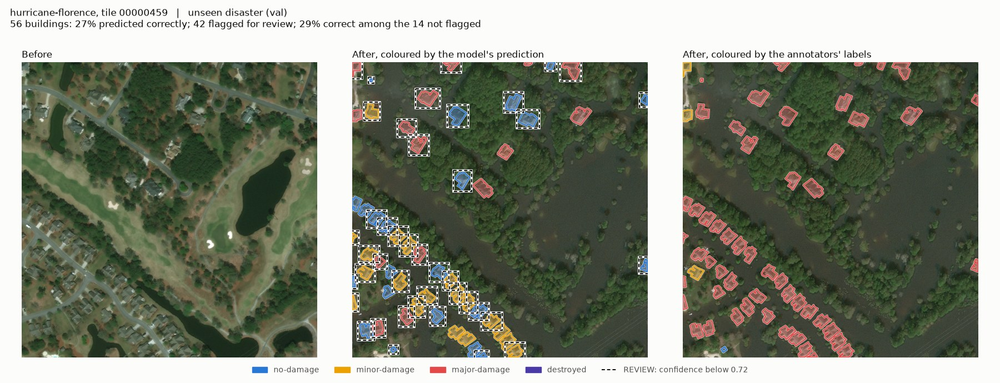
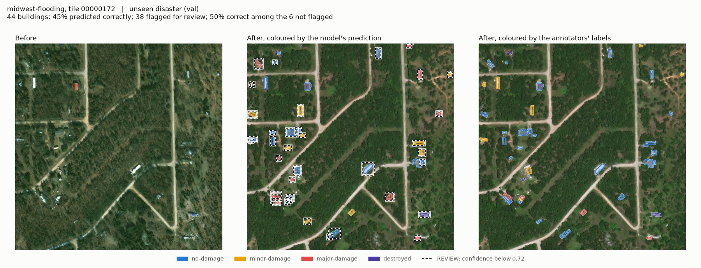
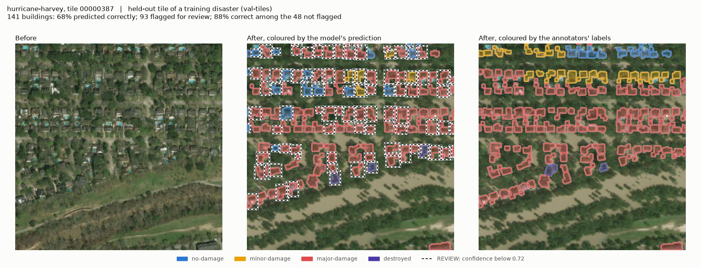
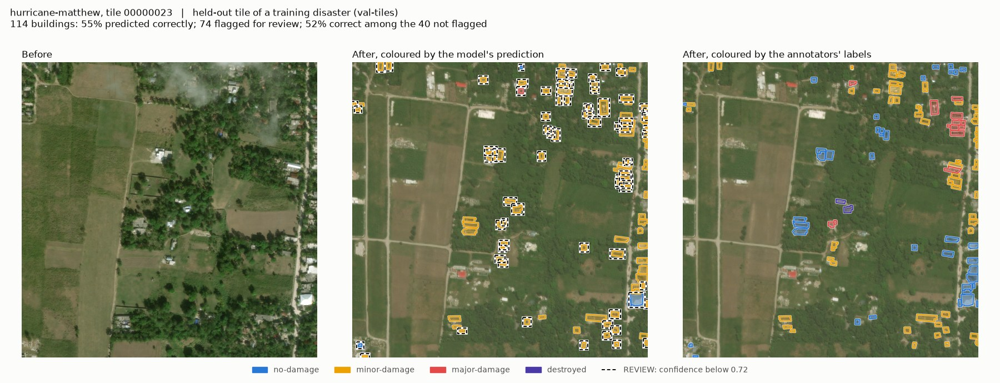
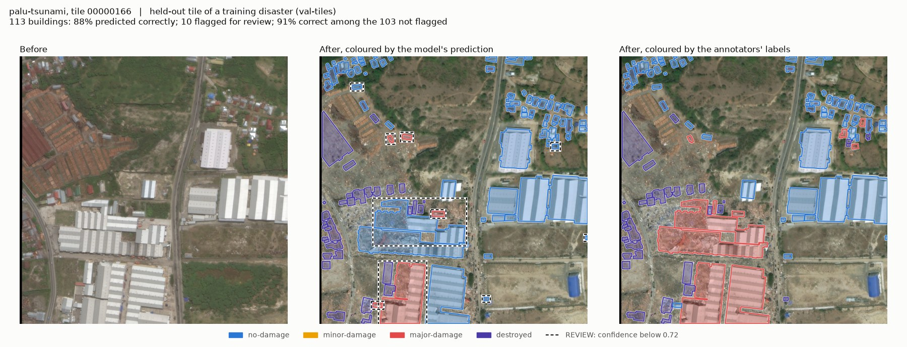
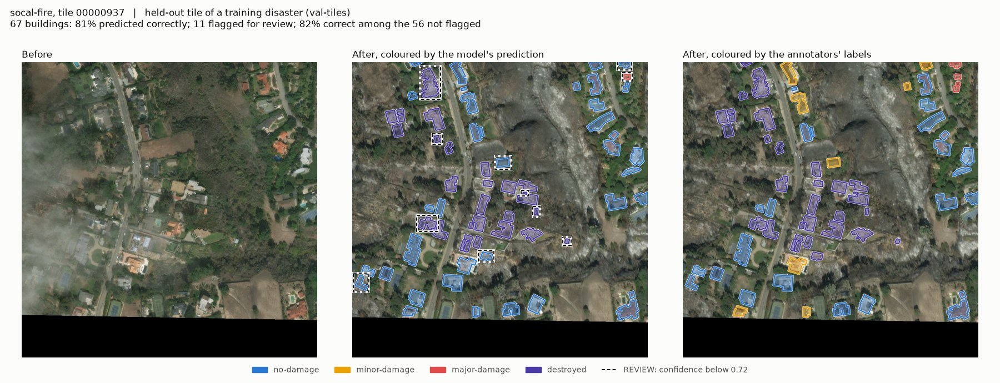

# Demo: predictions on whole tiles (validation only)

Generated by `scripts/demo_figures.py` from `runs/siamese_s0`. One tile per disaster: two disasters the model never trained on (val) and four held-out tiles of training disasters (val-tiles). No test-set tile is shown.

Tiles were picked from the annotators' labels (the tile with the most kinds of damage, then the most damaged buildings, among tiles with 25-160 buildings), **not** by how well the model did on them. They are examples, not a summary: the numbers that describe the model are in `docs/results.md`.

**REVIEW** marks buildings whose confidence is below 0.724, the threshold that auto-accepts 80% of val-tiles buildings. With that one threshold, 20% of val-tiles buildings and 72% of val buildings are flagged.

## hurricane-florence, tile 00000459 (val)

56 buildings, 27% predicted correctly, 42 flagged; 29% correct among those not flagged.

## midwest-flooding, tile 00000172 (val)

44 buildings, 45% predicted correctly, 38 flagged; 50% correct among those not flagged.

## hurricane-harvey, tile 00000387 (val-tiles)

141 buildings, 68% predicted correctly, 93 flagged; 88% correct among those not flagged.

## hurricane-matthew, tile 00000023 (val-tiles)

114 buildings, 55% predicted correctly, 74 flagged; 52% correct among those not flagged.

## palu-tsunami, tile 00000166 (val-tiles)

113 buildings, 88% predicted correctly, 10 flagged; 91% correct among those not flagged.

## socal-fire, tile 00000937 (val-tiles)

67 buildings, 81% predicted correctly, 11 flagged; 82% correct among those not flagged.

