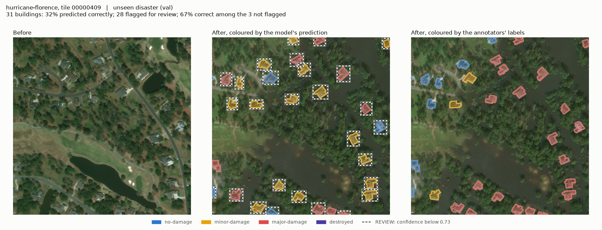
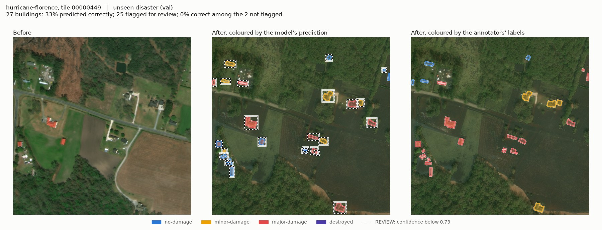
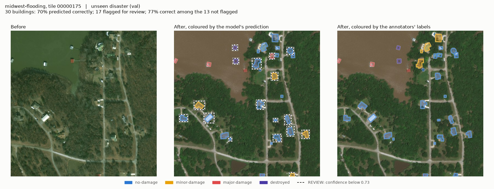
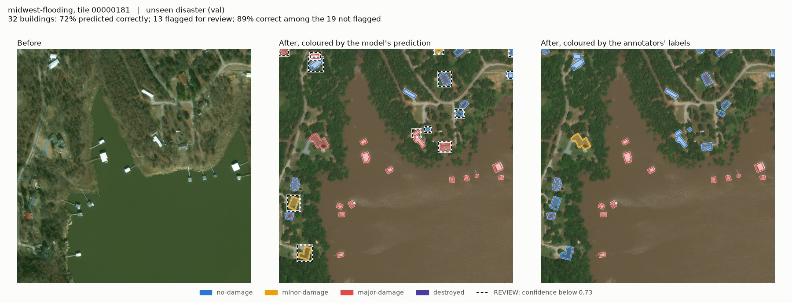

# Demo: predictions on whole tiles (validation only)

Generated by `scripts/demo_figures.py` from `runs/stack_aug_s0`. Parts shown: val; 3 tile(s) per disaster. Every figure says in its title which part its tile is from. No test-set tile is shown.

Tiles were picked from the annotators' labels (the tile with the most kinds of damage, then the most damaged buildings, among tiles with 25-160 buildings), **not** by how well the model did on them. They are examples, not a summary: the numbers that describe the model are in `docs/results.md`.

**REVIEW** marks buildings whose confidence is below 0.732, the threshold that auto-accepts 80% of val-tiles buildings. With that one threshold, 20% of val-tiles buildings and 69% of val buildings are flagged.

## hurricane-florence, tile 00000459 (val)

56 buildings, 34% predicted correctly, 48 flagged; 25% correct among those not flagged.

## hurricane-florence, tile 00000409 (val)

31 buildings, 32% predicted correctly, 28 flagged; 67% correct among those not flagged.

## hurricane-florence, tile 00000449 (val)

27 buildings, 33% predicted correctly, 25 flagged; 0% correct among those not flagged.

## midwest-flooding, tile 00000172 (val)

44 buildings, 59% predicted correctly, 21 flagged; 65% correct among those not flagged.

## midwest-flooding, tile 00000175 (val)

30 buildings, 70% predicted correctly, 17 flagged; 77% correct among those not flagged.

## midwest-flooding, tile 00000181 (val)

32 buildings, 72% predicted correctly, 13 flagged; 89% correct among those not flagged.

