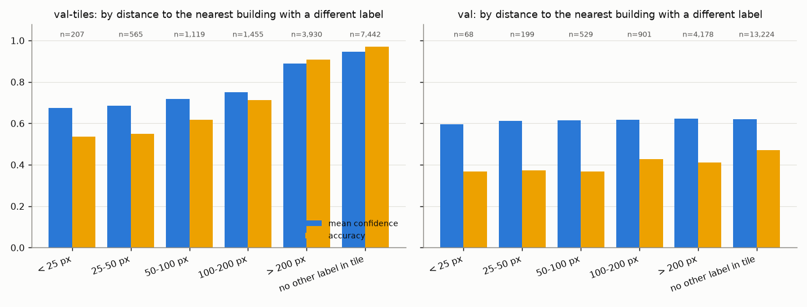
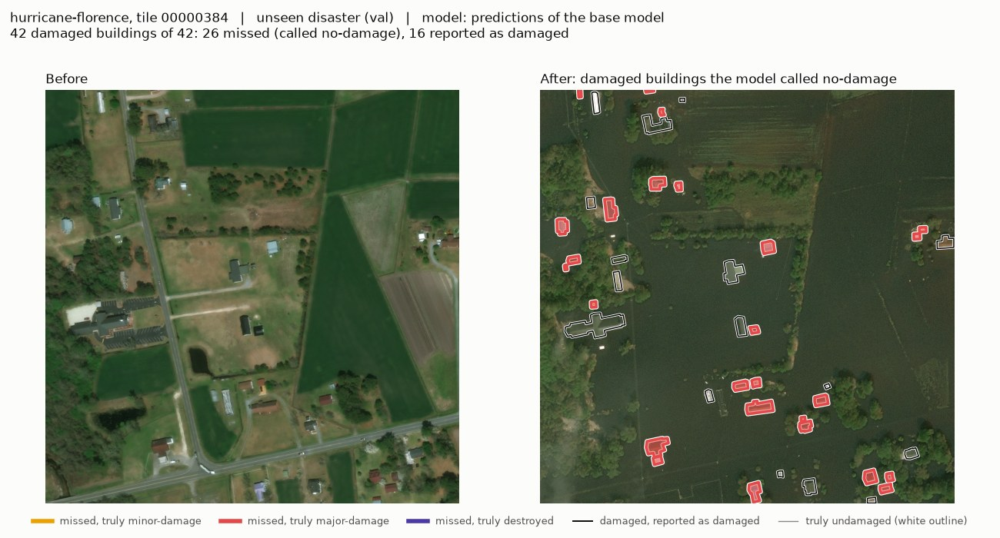
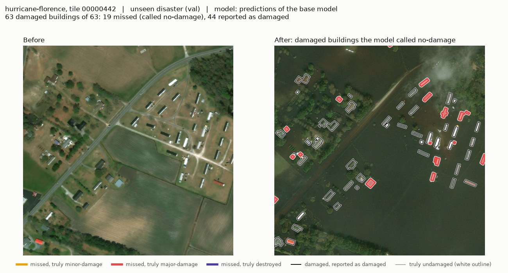
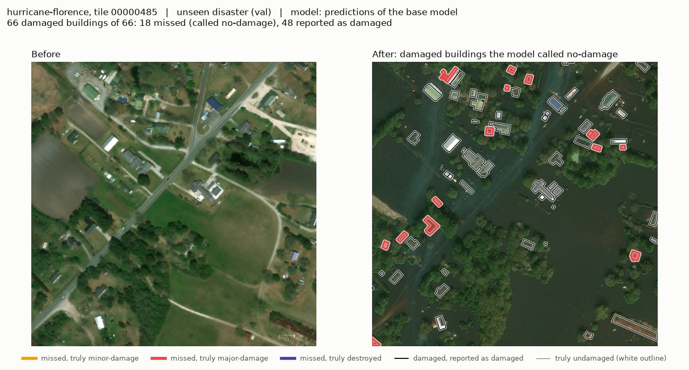
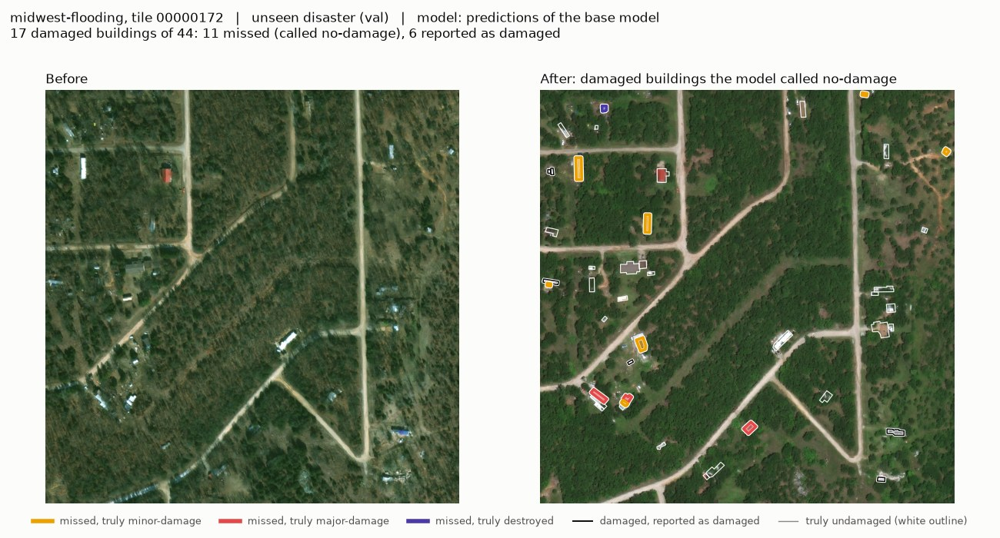
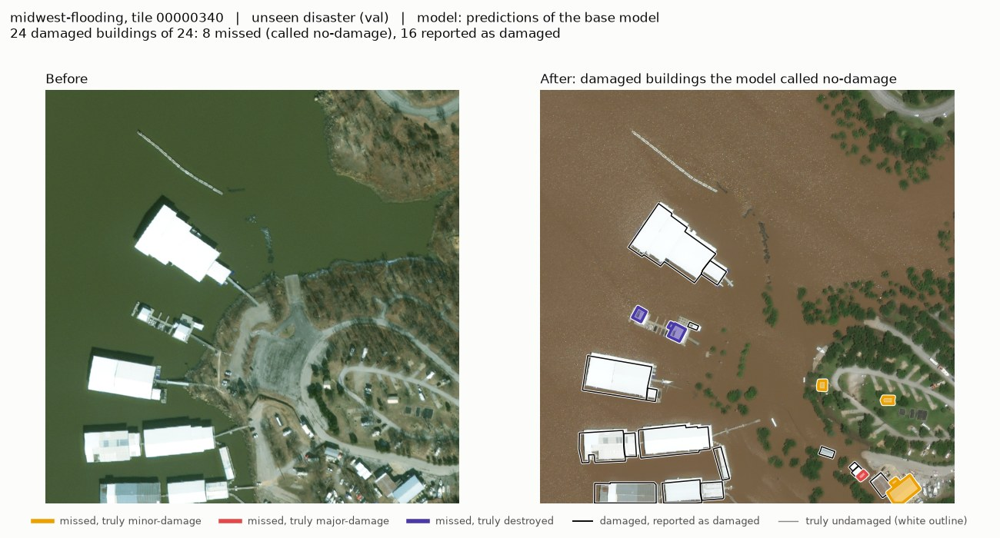
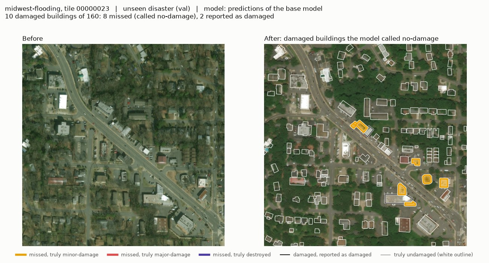
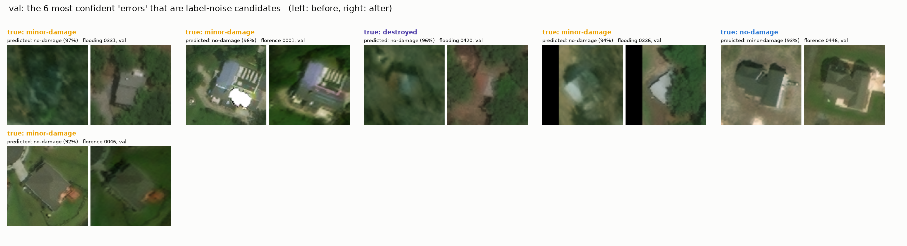

# Error analysis (validation only)

Generated by `scripts/error_analysis.py` from `runs/stack_aug_s0` (33,817 buildings on val-tiles and val; the test set is not touched). Confidence = top class probability after temperature scaling (T = 1.287). Overall numbers are in `docs/results.md`.

Reading the tables: a group with few buildings of some class has a noisy recall for it, and macro-F1 averages only over classes present in the group, so compare groups with care. Blank recall = no buildings of that class in the group.

<!-- reading:start -->
## Reading (written by hand, 2026-10-10)

Model: the base model, seed 0 (`runs/stack_aug_s0`). Sections 1-7 are as before; 8-11
were added for this reading. If the tables are regenerated from other predictions,
check this text against them.

**Where the errors are (section 8).**

- On val the bulk of the errors are false alarms, not misses: of 16,770 undamaged
  buildings, 3,658 are called minor-damage and 2,105 major-damage. Only 64% of the
  undamaged buildings are recognised as such, in both val disasters alike.
- On val-tiles the picture differs by disaster. hurricane-matthew: 388 of 406 undamaged
  buildings are called minor-damage (3% found). hurricane-harvey: minor-damage is found
  12% of the time and destroyed 1% (71 of 76 destroyed buildings are called
  major-damage). mexico-earthquake, palu-tsunami and socal-fire are 96-100% right on
  undamaged buildings. The overall val-tiles score hides these differences.

**Which damaged buildings are missed, that is, called no-damage (section 9).**

- By disaster: on val, hurricane-florence holds 76% of the misses (590 of 780), because
  it holds most of the damaged buildings; midwest-flooding has the higher miss rate
  (42% against 32%). On val-tiles, hurricane-harvey holds 73% of the misses.
- By class: minor-damage is missed most often (59% on val, 27% on val-tiles), destroyed
  least (23% and 8%). In numbers of buildings, major-damage in florence is the largest
  single group: 482 misses.
- By size: on val, small buildings are missed somewhat more often (39% under 20 px, 28%
  at 40-80 px). On val-tiles it is the other way round (9% under 20 px, 22% at 40-80
  px), which mostly reflects harvey, where the missed buildings are mid-sized. Size is
  not a consistent explanation.
- Buildings cut by the tile edge are missed more often (val: 48% against 33%), but
  there are few of them (147 damaged ones on val).
- The misses are not low-confidence cases: their mean confidence is 0.59-0.69 on val,
  about the same as the model's average confidence there.

**Example tiles (section 10)** show the six val tiles with the most misses. They are
worst cases by construction.

**Are the most confident "errors" label noise? (section 11)** Mostly not, by this
measure.

- 203 val buildings (1.1%) are label-noise candidates: their label differs from all 5
  nearest neighbours.
- Among the 100 most confident errors on val, 7 are candidates; among the top 500, 43
  (8.6%); among all 7,570 errors, 145 (1.9%). So candidates are about 5 to 9 times
  more common among the most confident errors than among val buildings in general,
  and in three quarters of those cases the model predicts what the neighbours are
  labelled (32 of 43).
- But 9 in 10 of the most confident errors are *not* candidates. Label noise of this
  kind explains a small part of the confident errors, not most of them.
- Limits: the rule only sees a label that disagrees with its neighbours. A whole
  street labelled too high or too low would never be flagged, and the model's
  confident false alarms on val (whole neighbourhoods called damaged) are of exactly
  that neighbourhood-wide kind. Agreement between the model and the neighbours is also
  weak evidence, since the crop shows some of the neighbourhood. And a candidate is not
  proof of a wrong label.
- The six examples: five are buildings labelled damaged that the model calls no-damage
  with 92-97% confidence while their neighbours are labelled no-damage; one is the
  reverse. They are shown for inspection by eye. **No label was changed.**
<!-- reading:end -->

## 1. Per disaster

| split | disaster | buildings | accuracy | macro-F1 | mean confidence | recall no-dmg | recall minor | recall major | recall destr. |
|---|---|---|---|---|---|---|---|---|---|
| val-tiles | guatemala-volcano | 97 | 0.629 | 0.281 | 0.766 | 0.853 | 0.000 | 0.167 | 0.095 |
| val-tiles | hurricane-harvey | 2,932 | 0.646 | 0.407 | 0.658 | 0.720 | 0.121 | 0.832 | 0.013 |
| val-tiles | hurricane-matthew | 1,191 | 0.511 | 0.433 | 0.720 | 0.030 | 0.926 | 0.233 | 0.739 |
| val-tiles | mexico-earthquake | 5,689 | 0.996 | 0.249 | 0.977 | 0.998 | 0.000 | 0.000 |  |
| val-tiles | palu-tsunami | 2,939 | 0.960 | 0.513 | 0.920 | 0.979 |  | 0.226 | 0.863 |
| val-tiles | socal-fire | 1,870 | 0.945 | 0.451 | 0.927 | 0.961 | 0.000 | 0.000 | 0.921 |
| val | hurricane-florence | 8,237 | 0.586 | 0.326 | 0.631 | 0.649 | 0.280 | 0.391 | 0.219 |
| val | midwest-flooding | 10,862 | 0.617 | 0.281 | 0.644 | 0.629 | 0.184 | 0.681 | 0.220 |

## 2. By building size

Longest side of the bounding box, in pixels of the original tile (every crop is resized to 128 px, so a small building is magnified and blurry).

| split | size | buildings | accuracy | macro-F1 | mean confidence | recall no-dmg | recall minor | recall major | recall destr. |
|---|---|---|---|---|---|---|---|---|---|
| val-tiles | < 20 px | 2,506 | 0.849 | 0.665 | 0.869 | 0.886 | 0.811 | 0.447 | 0.758 |
| val-tiles | 20-40 px | 5,919 | 0.887 | 0.705 | 0.891 | 0.928 | 0.680 | 0.661 | 0.696 |
| val-tiles | 40-80 px | 5,284 | 0.849 | 0.662 | 0.853 | 0.922 | 0.203 | 0.815 | 0.711 |
| val-tiles | > 80 px | 1,009 | 0.943 | 0.682 | 0.891 | 0.972 | 0.235 | 0.742 | 0.727 |
| val | < 20 px | 3,634 | 0.573 | 0.287 | 0.603 | 0.625 | 0.254 | 0.248 | 0.400 |
| val | 20-40 px | 6,987 | 0.591 | 0.291 | 0.630 | 0.622 | 0.148 | 0.422 | 0.171 |
| val | 40-80 px | 7,649 | 0.618 | 0.297 | 0.654 | 0.641 | 0.281 | 0.493 | 0.000 |
| val | > 80 px | 829 | 0.712 | 0.324 | 0.722 | 0.757 | 0.233 | 0.523 | 0.000 |

## 3. Cut by the tile edge vs not

A building counts as cut if its bounding box is within 1 px of the tile border; part of its crop is then black padding.

| split | position | buildings | accuracy | macro-F1 | mean confidence | recall no-dmg | recall minor | recall major | recall destr. |
|---|---|---|---|---|---|---|---|---|---|
| val-tiles | cut by tile edge | 876 | 0.840 | 0.642 | 0.847 | 0.901 | 0.397 | 0.744 | 0.600 |
| val-tiles | inside tile | 13,842 | 0.873 | 0.695 | 0.875 | 0.924 | 0.493 | 0.730 | 0.725 |
| val | cut by tile edge | 1,228 | 0.596 | 0.260 | 0.636 | 0.630 | 0.125 | 0.407 | 0.000 |
| val | inside tile | 17,871 | 0.604 | 0.306 | 0.638 | 0.637 | 0.239 | 0.415 | 0.225 |

## 4. Label-noise candidates

Same rule as `docs/label_noise.md`, applied here to val-tiles and val only: a building is a *candidate* if its label differs from the label of all 5 of its nearest neighbours in the tile. 'Other eligible' = the remaining buildings in tiles with at least 6 classified buildings. A candidate is not necessarily mislabelled: one burnt house on an intact street is real.

| split | group | buildings | mean confidence | median confidence | model agrees with the label | model agrees with neighbours' majority |
|---|---|---|---|---|---|---|
| val-tiles | candidate | 159 | 0.716 | 0.739 | 0.409 | 0.403 |
| val-tiles | other eligible | 14,519 | 0.876 | 0.971 | 0.876 | 0.868 |
| val | candidate | 203 | 0.635 | 0.595 | 0.286 | 0.463 |
| val | other eligible | 18,304 | 0.639 | 0.615 | 0.611 | 0.611 |

How to read it: if candidates were mostly real damage, the model should agree with their labels about as often as elsewhere. If they were mostly label mistakes, the model should side with the neighbours. Neither can be told apart from 'the model just follows the neighbourhood', because the crop includes context around the building.

## 5. Is uncertainty higher near damage boundaries?

Hypothesis 2 in `docs/observations.md`. For each building: distance (pixel centroids) to the nearest building *in the same tile* with a different label. Small distance = on a damage boundary.

| split | distance | buildings | accuracy | mean confidence | macro-F1 |
|---|---|---|---|---|---|
| val-tiles | < 25 px | 207 | 0.517 | 0.719 | 0.496 |
| val-tiles | 25-50 px | 565 | 0.524 | 0.730 | 0.517 |
| val-tiles | 50-100 px | 1,119 | 0.594 | 0.731 | 0.607 |
| val-tiles | 100-200 px | 1,455 | 0.690 | 0.748 | 0.660 |
| val-tiles | > 200 px | 3,930 | 0.899 | 0.868 | 0.700 |
| val-tiles | no other label in tile | 7,442 | 0.969 | 0.938 | 0.474 |
| val | < 25 px | 68 | 0.382 | 0.623 | 0.355 |
| val | 25-50 px | 199 | 0.462 | 0.644 | 0.388 |
| val | 50-100 px | 529 | 0.507 | 0.641 | 0.398 |
| val | 100-200 px | 901 | 0.615 | 0.657 | 0.410 |
| val | > 200 px | 4,178 | 0.614 | 0.648 | 0.311 |
| val | no other label in tile | 13,224 | 0.607 | 0.634 | 0.269 |

Spearman rank correlation between distance and confidence (buildings with a different label somewhere in their tile): val-tiles +0.409, val -0.004. Positive = confidence rises with distance from the boundary.

Caveats: the distance only sees neighbours inside the same tile, so a boundary just across the tile border is missed; and 'near a different label' is also where a wrong label is most likely, so lower accuracy there mixes model errors with label noise.

## 6. Gallery

Written to `runs/stack_aug_s0/gallery/` (not in git): `confident_mistakes.png` and `unsure_correct.png`, each with pre and post crops, plus a CSV of the same buildings.

- The 20 most confident mistakes (confidence 0.995-0.999), as true -> predicted: minor -> no-dmg (6), major -> destr. (5), no-dmg -> destr. (4), destr. -> no-dmg (4), no-dmg -> major (1). By disaster: socal-fire (8), palu-tsunami (8), mexico-earthquake (2), hurricane-florence (1), midwest-flooding (1).
- The 20 least confident correct predictions (confidence 0.263-0.304): classes no-dmg (15), major (4), minor (1).

Confident mistakes are the ones to look at by eye: each is either a model failure worth understanding or a label worth questioning.

## 7. The same questions for every uncertainty method

Sections 4 and 5 used the temperature-scaled top probability of the seed-0 model. Here every available method is asked the same things (ensemble members: stack_aug_s0, stack_aug_s1, stack_aug_s2):

- **AUROC**: probability that a correct prediction gets a higher confidence than a wrong one (0.5 = useless, 1 = perfect);
- **rank correlation** between distance to the nearest differently-labelled building and confidence (section 5; positive = less sure near boundaries);
- **noise candidates in the least-confident 10%**: if confidence were unrelated to the label-noise candidates of section 4, this would be 10%.

| split | method | accuracy | AUROC: confidence separates right from wrong | rank corr.: distance to boundary vs confidence | noise candidates: share in least-confident 10% |
|---|---|---|---|---|---|
| val-tiles | max prob (raw) | 0.871 | 0.897 | 0.410 | 0.189 |
| val-tiles | max prob (temp. scaled) | 0.871 | 0.897 | 0.409 | 0.195 |
| val-tiles | ensemble of 3 | 0.876 | 0.899 | 0.420 | 0.245 |
| val-tiles | ensemble of 3 (temp. scaled) | 0.876 | 0.899 | 0.420 | 0.245 |
| val | max prob (raw) | 0.604 | 0.729 | -0.004 | 0.118 |
| val | max prob (temp. scaled) | 0.604 | 0.732 | -0.004 | 0.123 |
| val | ensemble of 3 | 0.640 | 0.744 | -0.006 | 0.118 |
| val | ensemble of 3 (temp. scaled) | 0.640 | 0.746 | -0.005 | 0.103 |

For entropy the 'confidence' is minus the predictive entropy, so only its ranking is meaningful.

## 8. Confusion per part, per disaster and per class

One row per true class: how many of its buildings the model put in each class (counts), and the share it got right ('found'). Classes that do not occur in a group are left out.

| buildings | true class | n | -> no-dmg | -> minor | -> major | -> destr. | found |
|---|---|---|---|---|---|---|---|
| val-tiles (all) | no-damage | 11,910 | 10,987 | 527 | 302 | 94 | 0.923 |
| val-tiles (all) | minor-damage | 888 | 235 | 431 | 208 | 14 | 0.485 |
| val-tiles (all) | major-damage | 1,205 | 182 | 90 | 881 | 52 | 0.731 |
| val-tiles (all) | destroyed | 715 | 55 | 55 | 89 | 516 | 0.722 |
| val (all) | no-damage | 16,770 | 10,668 | 3,658 | 2,105 | 339 | 0.636 |
| val (all) | minor-damage | 372 | 221 | 86 | 57 | 8 | 0.231 |
| val (all) | major-damage | 1,770 | 516 | 351 | 734 | 169 | 0.415 |
| val (all) | destroyed | 187 | 43 | 25 | 78 | 41 | 0.219 |
| val-tiles: guatemala-volcano | no-damage | 68 | 58 | 7 | 3 | 0 | 0.853 |
| val-tiles: guatemala-volcano | minor-damage | 2 | 0 | 0 | 2 | 0 | 0.000 |
| val-tiles: guatemala-volcano | major-damage | 6 | 5 | 0 | 1 | 0 | 0.167 |
| val-tiles: guatemala-volcano | destroyed | 21 | 13 | 4 | 2 | 2 | 0.095 |
| val-tiles: hurricane-harvey | no-damage | 1,381 | 995 | 121 | 264 | 1 | 0.720 |
| val-tiles: hurricane-harvey | minor-damage | 464 | 210 | 56 | 198 | 0 | 0.121 |
| val-tiles: hurricane-harvey | major-damage | 1,011 | 131 | 33 | 841 | 6 | 0.832 |
| val-tiles: hurricane-harvey | destroyed | 76 | 4 | 0 | 71 | 1 | 0.013 |
| val-tiles: hurricane-matthew | no-damage | 406 | 12 | 388 | 5 | 1 | 0.030 |
| val-tiles: hurricane-matthew | minor-damage | 405 | 8 | 375 | 8 | 14 | 0.926 |
| val-tiles: hurricane-matthew | major-damage | 116 | 3 | 56 | 27 | 30 | 0.233 |
| val-tiles: hurricane-matthew | destroyed | 264 | 3 | 51 | 15 | 195 | 0.739 |
| val-tiles: mexico-earthquake | no-damage | 5,676 | 5,664 | 2 | 7 | 3 | 0.998 |
| val-tiles: mexico-earthquake | minor-damage | 7 | 7 | 0 | 0 | 0 | 0.000 |
| val-tiles: mexico-earthquake | major-damage | 6 | 6 | 0 | 0 | 0 | 0.000 |
| val-tiles: palu-tsunami | no-damage | 2,747 | 2,689 | 5 | 21 | 32 | 0.979 |
| val-tiles: palu-tsunami | major-damage | 53 | 29 | 0 | 12 | 12 | 0.226 |
| val-tiles: palu-tsunami | destroyed | 139 | 19 | 0 | 0 | 120 | 0.863 |
| val-tiles: socal-fire | no-damage | 1,632 | 1,569 | 4 | 2 | 57 | 0.961 |
| val-tiles: socal-fire | minor-damage | 10 | 10 | 0 | 0 | 0 | 0.000 |
| val-tiles: socal-fire | major-damage | 13 | 8 | 1 | 0 | 4 | 0.000 |
| val-tiles: socal-fire | destroyed | 215 | 16 | 0 | 1 | 198 | 0.921 |
| val: hurricane-florence | no-damage | 6,365 | 4,128 | 1,497 | 476 | 264 | 0.649 |
| val: hurricane-florence | minor-damage | 182 | 91 | 51 | 35 | 5 | 0.280 |
| val: hurricane-florence | major-damage | 1,626 | 482 | 344 | 636 | 164 | 0.391 |
| val: hurricane-florence | destroyed | 64 | 17 | 16 | 17 | 14 | 0.219 |
| val: midwest-flooding | no-damage | 10,405 | 6,540 | 2,161 | 1,629 | 75 | 0.629 |
| val: midwest-flooding | minor-damage | 190 | 130 | 35 | 22 | 3 | 0.184 |
| val: midwest-flooding | major-damage | 144 | 34 | 7 | 98 | 5 | 0.681 |
| val: midwest-flooding | destroyed | 123 | 26 | 9 | 61 | 27 | 0.220 |

## 9. Missed damage: which buildings?

A *miss* is a truly damaged building (minor, major or destroyed) that the model calls no-damage. miss rate = misses / damaged buildings in the group. 'Share of the split's misses' says where the bulk of the misses is; a group can have a high miss rate and still hold few of them.

By disaster:

| split | disaster | damaged buildings | missed | miss rate | share of the split's misses | mean confidence of the misses |
|---|---|---|---|---|---|---|
| val-tiles | guatemala-volcano | 29 | 18 | 0.621 | 0.038 | 0.745 |
| val-tiles | hurricane-harvey | 1,551 | 345 | 0.222 | 0.731 | 0.609 |
| val-tiles | hurricane-matthew | 785 | 14 | 0.018 | 0.030 | 0.624 |
| val-tiles | mexico-earthquake | 13 | 13 | 1.000 | 0.028 | 0.979 |
| val-tiles | palu-tsunami | 192 | 48 | 0.250 | 0.102 | 0.799 |
| val-tiles | socal-fire | 238 | 34 | 0.143 | 0.072 | 0.866 |
| val | hurricane-florence | 1,872 | 590 | 0.315 | 0.756 | 0.594 |
| val | midwest-flooding | 457 | 190 | 0.416 | 0.244 | 0.691 |

By true class:

| split | true class | damaged buildings | missed | miss rate | share of the split's misses | mean confidence of the misses |
|---|---|---|---|---|---|---|
| val-tiles | minor-damage | 888 | 235 | 0.265 | 0.498 | 0.637 |
| val-tiles | major-damage | 1,205 | 182 | 0.151 | 0.386 | 0.668 |
| val-tiles | destroyed | 715 | 55 | 0.077 | 0.117 | 0.756 |
| val | minor-damage | 372 | 221 | 0.594 | 0.283 | 0.695 |
| val | major-damage | 1,770 | 516 | 0.292 | 0.662 | 0.587 |
| val | destroyed | 187 | 43 | 0.230 | 0.055 | 0.588 |

By building size (longest side of the bounding box, tile pixels):

| split | size | damaged buildings | missed | miss rate | share of the split's misses | mean confidence of the misses |
|---|---|---|---|---|---|---|
| val-tiles | < 20 px | 525 | 49 | 0.093 | 0.104 | 0.668 |
| val-tiles | 20-40 px | 979 | 134 | 0.137 | 0.284 | 0.681 |
| val-tiles | 40-80 px | 1,214 | 265 | 0.218 | 0.561 | 0.654 |
| val-tiles | > 80 px | 90 | 24 | 0.267 | 0.051 | 0.647 |
| val | < 20 px | 528 | 204 | 0.386 | 0.262 | 0.611 |
| val | 20-40 px | 822 | 296 | 0.360 | 0.379 | 0.618 |
| val | 40-80 px | 875 | 244 | 0.279 | 0.313 | 0.611 |
| val | > 80 px | 104 | 36 | 0.346 | 0.046 | 0.693 |

Cut by the tile edge or not:

| split | position | damaged buildings | missed | miss rate | share of the split's misses | mean confidence of the misses |
|---|---|---|---|---|---|---|
| val-tiles | cut by tile edge | 170 | 39 | 0.229 | 0.083 | 0.673 |
| val-tiles | inside tile | 2,638 | 433 | 0.164 | 0.917 | 0.662 |
| val | cut by tile edge | 147 | 70 | 0.476 | 0.090 | 0.651 |
| val | inside tile | 2,182 | 710 | 0.325 | 0.910 | 0.614 |

val, disaster and class together:

| val: disaster, true class | damaged buildings | missed | miss rate |
|---|---|---|---|
| hurricane-florence, destroyed | 64 | 17 | 0.266 |
| hurricane-florence, major-damage | 1,626 | 482 | 0.296 |
| hurricane-florence, minor-damage | 182 | 91 | 0.500 |
| midwest-flooding, destroyed | 123 | 26 | 0.211 |
| midwest-flooding, major-damage | 144 | 34 | 0.236 |
| midwest-flooding, minor-damage | 190 | 130 | 0.684 |

## 10. Example tiles of missed damage (val)

The 6 val tiles with the most missed buildings, 3 per disaster (tiles with at most 200 buildings). **They are the worst cases, picked because the model failed on them, not typical tiles.** All are from val, the unseen disasters; every figure says so in its title.

**hurricane-florence, tile 00000384 (val)**: 42 damaged buildings of 42, 26 missed.

**hurricane-florence, tile 00000442 (val)**: 63 damaged buildings of 63, 19 missed.

**hurricane-florence, tile 00000485 (val)**: 66 damaged buildings of 66, 18 missed.

**midwest-flooding, tile 00000172 (val)**: 17 damaged buildings of 44, 11 missed.

**midwest-flooding, tile 00000340 (val)**: 24 damaged buildings of 24, 8 missed.

**midwest-flooding, tile 00000023 (val)**: 10 damaged buildings of 160, 8 missed.

## 11. Are the most confident 'errors' on val label noise?

An 'error' is a val building whose prediction differs from its label; 7,570 of 19,099. They are sorted by the model's confidence, highest first. A *label-noise candidate* (`docs/label_noise.md`, `outputs/label_noise/candidates.csv`) is a building whose label differs from the label of all 5 nearest neighbours in its tile; 203 val buildings are candidates (1.1% of val), so that is the share to expect if confident errors had nothing to do with label noise. **No label was changed.** The candidates file also contains test-disaster rows from the first data exploration; they are discarded on reading and play no part here.

| errors looked at | lowest confidence among them | label-noise candidates | share | of those, model predicts the neighbours' class |
|---|---|---|---|---|
| top 50 | 0.954 | 3 | 0.060 | 3 |
| top 100 | 0.923 | 7 | 0.070 | 6 |
| top 200 | 0.879 | 19 | 0.095 | 14 |
| top 500 | 0.799 | 43 | 0.086 | 32 |
| top 1,000 | 0.718 | 55 | 0.055 | 41 |
| all 7,570 | 0.258 | 145 | 0.019 | 94 |

The 6 most confident errors that are candidates (all val):

| disaster | tile_id | uid | label | predicted | confidence | neighbours' most common class |
|---|---|---|---|---|---|---|
| midwest-flooding | 00000331 | 8a9c842e-a207-4199-8309-92fba03d0232 | minor-damage | no-damage | 0.967 | no-damage |
| hurricane-florence | 00000001 | 7d5a725e-b63f-4f50-bd74-ca643f2dae9a | minor-damage | no-damage | 0.963 | no-damage |
| midwest-flooding | 00000420 | df81856b-e52f-4a1f-9da4-a0cfc7177ea0 | destroyed | no-damage | 0.960 | no-damage |
| midwest-flooding | 00000336 | 585ae5dd-8f60-4d17-b265-685aaef9f0fe | minor-damage | no-damage | 0.935 | no-damage |
| hurricane-florence | 00000446 | c9a89df9-ad46-4a4a-82ff-2f1655f4ed6e | no-damage | minor-damage | 0.926 | major-damage |
| hurricane-florence | 00000046 | 6ea113a9-d74e-48ca-880e-5eec8034035b | minor-damage | no-damage | 0.924 | no-damage |

