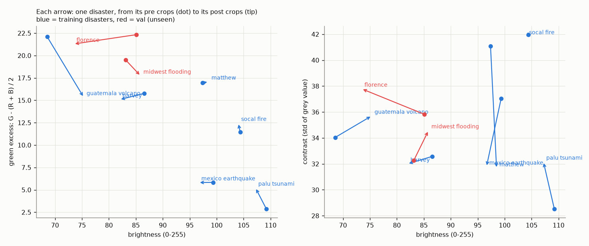

# Gap diagnosis: why is val worse than val-tiles? (validation only)

Generated by `scripts/gap_diagnosis.py` from `stack_aug_s0`, `stack_aug_s1`, `stack_aug_s2`. Training and validation crops only; the test set is not touched.

## (a) Which input carries the shift?

The trained models are run again with one input replaced. Numbers are the mean over 3 seed(s). 'predicted no-damage' is the share of buildings the model calls undamaged; compare it with 'truly no-damage'.

- **both = pre / both = post**: the model gets the same image twice, so nothing has changed between its two inputs. A model that compares before and after should answer no-damage for nearly everything.
- **pre blank / post blank**: one input is a flat grey image. Shows how much the model depends on that input.

| buildings | input | accuracy | macro-F1 | predicted no-damage | predicted no-damage, range over seeds | mean top probability | truly no-damage |
|---|---|---|---|---|---|---|---|
| val-tiles (all) | normal | 0.870 | 0.694 | 0.777 | 0.77-0.78 | 0.904 | 0.809 |
| val-tiles (all) | both = pre | 0.802 | 0.328 | 0.936 | 0.93-0.94 | 0.933 | 0.809 |
| val-tiles (all) | both = post | 0.869 | 0.659 | 0.842 | 0.83-0.85 | 0.904 | 0.809 |
| val-tiles (all) | pre blank | 0.736 | 0.547 | 0.631 | 0.62-0.64 | 0.802 | 0.809 |
| val-tiles (all) | post blank | 0.501 | 0.236 | 0.511 | 0.45-0.60 | 0.813 | 0.809 |
| val (all) | normal | 0.617 | 0.304 | 0.619 | 0.60-0.64 | 0.700 | 0.878 |
| val (all) | both = pre | 0.616 | 0.230 | 0.696 | 0.66-0.73 | 0.767 | 0.878 |
| val (all) | both = post | 0.827 | 0.287 | 0.924 | 0.92-0.93 | 0.876 | 0.878 |
| val (all) | pre blank | 0.663 | 0.316 | 0.656 | 0.64-0.67 | 0.701 | 0.878 |
| val (all) | post blank | 0.132 | 0.089 | 0.119 | 0.06-0.18 | 0.709 | 0.878 |
| val: hurricane-florence | normal | 0.605 | 0.321 | 0.604 | 0.57-0.62 | 0.687 | 0.773 |
| val: hurricane-florence | both = pre | 0.698 | 0.251 | 0.882 | 0.85-0.92 | 0.840 | 0.773 |
| val: hurricane-florence | both = post | 0.683 | 0.236 | 0.882 | 0.87-0.89 | 0.820 | 0.773 |
| val: hurricane-florence | pre blank | 0.497 | 0.285 | 0.471 | 0.45-0.49 | 0.638 | 0.773 |
| val: hurricane-florence | post blank | 0.081 | 0.069 | 0.064 | 0.05-0.08 | 0.676 | 0.773 |
| val: midwest-flooding | normal | 0.627 | 0.287 | 0.629 | 0.61-0.66 | 0.710 | 0.958 |
| val: midwest-flooding | both = pre | 0.554 | 0.211 | 0.555 | 0.52-0.58 | 0.711 | 0.958 |
| val: midwest-flooding | both = post | 0.936 | 0.377 | 0.956 | 0.95-0.96 | 0.918 | 0.958 |
| val: midwest-flooding | pre blank | 0.789 | 0.312 | 0.796 | 0.76-0.83 | 0.748 | 0.958 |
| val: midwest-flooding | post blank | 0.171 | 0.091 | 0.161 | 0.07-0.25 | 0.735 | 0.958 |

The same numbers in words:

- **val-tiles**: accuracy is 0.870 normally and 0.869 when the pre image is replaced by the post image (macro-F1 0.694 and 0.659). With the post image blanked it is 0.501; with the pre image blanked 0.736.
- **hurricane-florence** (77% of buildings truly undamaged): the model calls 60% undamaged normally, 88% when it sees the pre image twice and 88% when it sees the post image twice. Accuracy: 0.605 normally, 0.497 with the pre image blanked, 0.683 with the post image twice.
- **midwest-flooding** (96% of buildings truly undamaged): the model calls 63% undamaged normally, 55% when it sees the pre image twice and 96% when it sees the post image twice. Accuracy: 0.627 normally, 0.789 with the pre image blanked, 0.936 with the post image twice.

How to read it:

- If 'both = post' on val predicts far less no-damage than on val-tiles, the post images of the unseen disasters look like damage to the model by themselves, whatever the pre image shows.
- If 'both = pre' on val still predicts a lot of damage, the pre images are unfamiliar too.
- If 'pre blank' barely changes the predictions compared with 'normal', the model is mostly reading the post image and hardly comparing.

Caveat: a pair of identical images is itself unlike anything in training (real pairs always differ a little), so these are probes of the model's behaviour, not measurements of accuracy.

## (b) Colour statistics per disaster

Up to 3,000 crops per disaster and part, black padding excluded; training disasters pool their train and val-tiles crops. Brightness = mean of R, G, B (0-255); contrast = standard deviation of the grey value; green excess = G - (R + B) / 2.

| role | disaster | crops | pre brightness | post brightness | post - pre brightness | pre contrast | post contrast | pre green excess | post green excess |
|---|---|---|---|---|---|---|---|---|---|
| training disaster | guatemala-volcano | 712 | 68.6 | 75.3 | 6.8 | 34.0 | 35.7 | 22.1 | 15.3 |
| training disaster | hurricane-harvey | 5,932 | 86.6 | 82.0 | -4.6 | 32.6 | 32.0 | 15.8 | 15.1 |
| training disaster | hurricane-matthew | 4,191 | 97.4 | 98.5 | 1.1 | 41.1 | 31.6 | 16.9 | 17.1 |
| training disaster | mexico-earthquake | 6,000 | 99.3 | 96.6 | -2.7 | 37.0 | 31.8 | 5.8 | 5.8 |
| training disaster | palu-tsunami | 5,939 | 109.2 | 107.2 | -2.0 | 28.5 | 32.2 | 2.9 | 5.2 |
| training disaster | socal-fire | 4,870 | 104.4 | 104.0 | -0.4 | 42.0 | 41.8 | 11.4 | 12.5 |
| val (unseen) | hurricane-florence | 3,000 | 85.1 | 73.5 | -11.7 | 35.8 | 37.8 | 22.3 | 21.3 |
| val (unseen) | midwest-flooding | 3,000 | 83.1 | 85.9 | 2.8 | 32.2 | 34.6 | 19.5 | 17.7 |

Mean colour per channel:

| role | disaster | pre R | pre G | pre B | post R | post G | post B |
|---|---|---|---|---|---|---|---|
| training disaster | guatemala-volcano | 66.8 | 83.3 | 55.6 | 77.9 | 85.6 | 62.6 |
| training disaster | hurricane-harvey | 88.7 | 97.1 | 74.0 | 84.1 | 92.0 | 69.9 |
| training disaster | hurricane-matthew | 100.5 | 108.7 | 83.0 | 102.1 | 109.9 | 83.5 |
| training disaster | mexico-earthquake | 109.4 | 103.2 | 85.4 | 107.4 | 100.5 | 82.0 |
| training disaster | palu-tsunami | 115.6 | 111.1 | 101.0 | 112.0 | 110.7 | 98.9 |
| training disaster | socal-fire | 107.4 | 112.0 | 93.8 | 108.3 | 112.3 | 91.4 |
| val (unseen) | hurricane-florence | 83.5 | 100.0 | 71.9 | 72.0 | 87.6 | 60.8 |
| val (unseen) | midwest-flooding | 83.8 | 96.1 | 69.4 | 88.0 | 97.7 | 71.9 |

Are the val disasters outside what the model saw in training?

- pre brightness: training disasters 69-109; hurricane-florence 85 (inside), midwest-flooding 83 (inside)
- post brightness: training disasters 75-107; hurricane-florence 73 (below), midwest-flooding 86 (inside)
- pre green excess: training disasters 3-22; hurricane-florence 22 (above), midwest-flooding 19 (inside)
- post green excess: training disasters 5-17; hurricane-florence 21 (above), midwest-flooding 18 (above)
- post contrast: training disasters 32-42; hurricane-florence 38 (inside), midwest-flooding 35 (inside)

These are averages over whole disasters. Being inside the range of averages does not mean the images look alike, and being outside it does not prove that colour is the cause of the gap; the fixes in `docs/results.md` test that directly.
