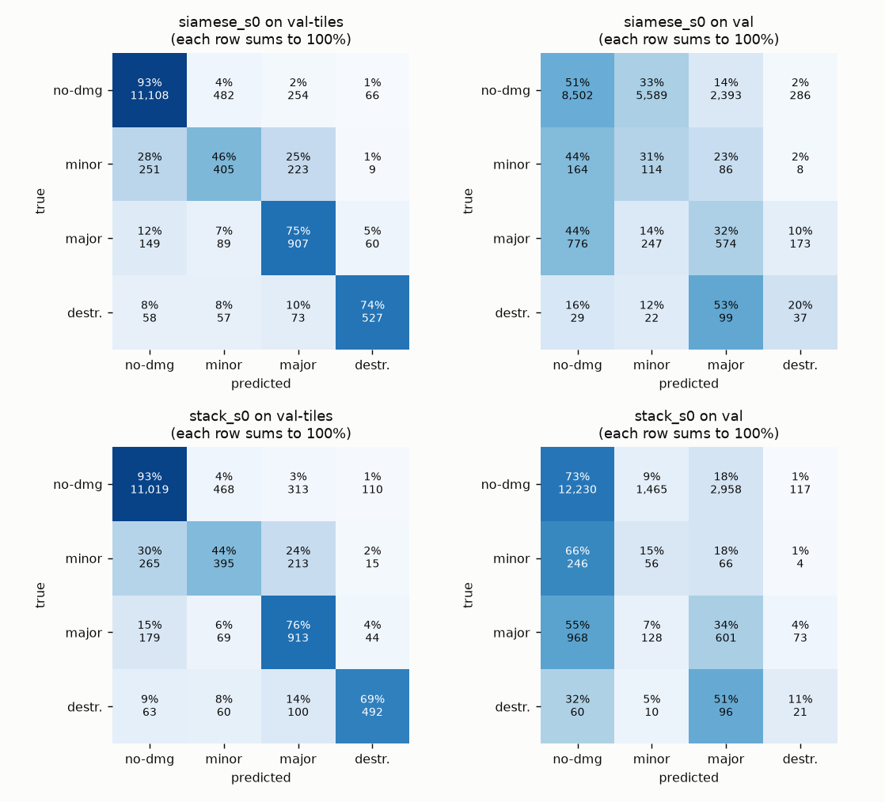
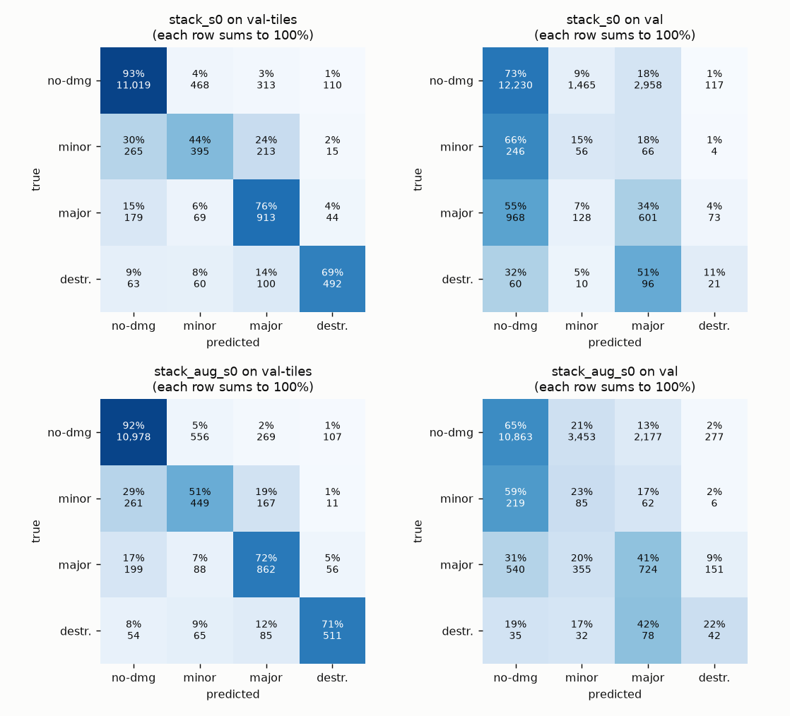
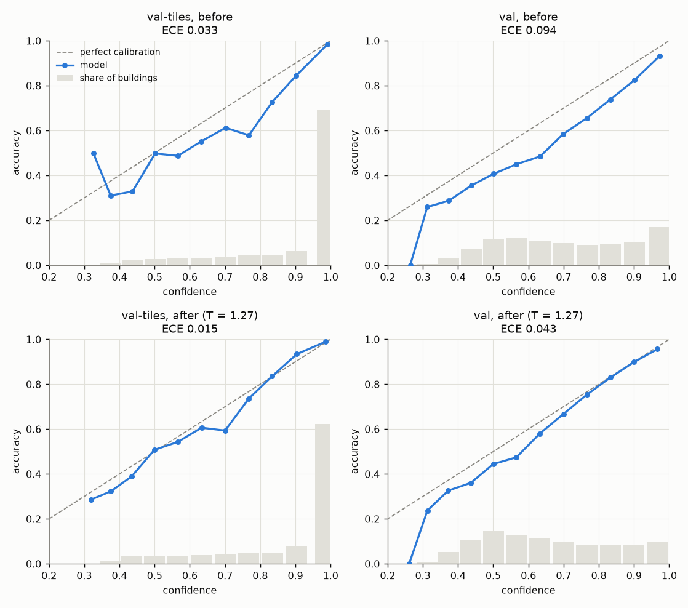
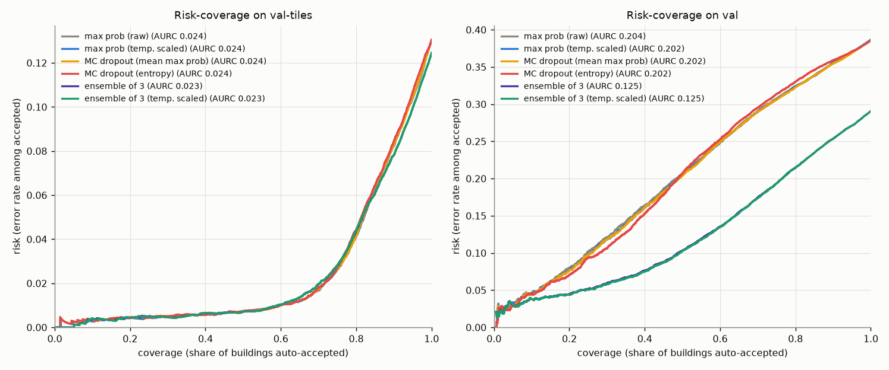
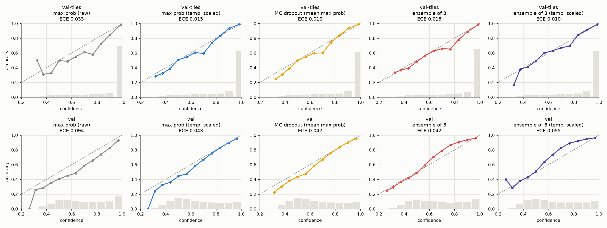
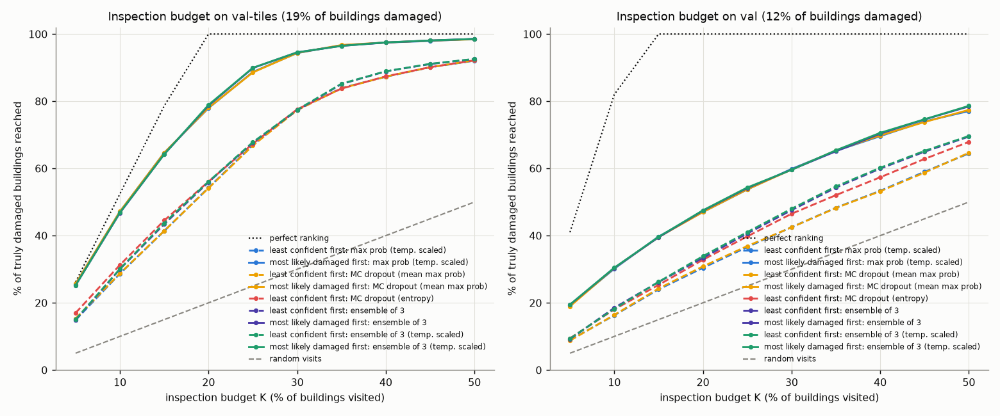

# Results (validation only)

Generated by `scripts/make_results.py` from `runs/`. **Every number here is on val-tiles or val. The test set (hurricane-michael, santa-rosa-wildfire) has not been loaded, evaluated or looked at**; `src/split.py` blocks it unless `--final` is passed.

- **val-tiles**: held-out spatial blocks of the six *training* disasters (14,718 buildings). Used for model selection and for fitting the temperature, so scores on it are optimistic.
- **val**: hurricane-florence and midwest-flooding, never trained on (19,099 buildings). Floods only, with few minor-damage and destroyed buildings (372 and 187), so its per-class numbers for those two classes are noisy.

> **val is now used for model selection.** The epoch whose weights are kept is the one with the highest *mean of the val-tiles and val macro-F1*, and the architecture and augmentation choices below were judged on val. val scores are therefore no longer an untouched estimate for a new disaster: they are somewhat optimistic. The only untouched data is the test set.

Un-classified buildings are dropped (`docs/data_decisions.md`). Recall of a class = share of its buildings that were predicted as that class. Macro-F1 = plain average of the four per-class F1 scores.

## 1. Baselines

What you get without looking at any image. Class shares in train: no-damage 73.8%, minor-damage 8.8%, major-damage 9.4%, destroyed 8.0%.

| split | baseline | accuracy | macro-F1 | recall no-dmg | recall minor | recall major | recall destr. |
|---|---|---|---|---|---|---|---|
| val-tiles | majority class (no-damage) | 0.809 | 0.224 | 1.000 | 0.000 | 0.000 | 0.000 |
| val-tiles | random, weighted by train class frequency | 0.615 | 0.248 | 0.739 | 0.088 | 0.094 | 0.080 |
| val | majority class (no-damage) | 0.878 | 0.234 | 1.000 | 0.000 | 0.000 | 0.000 |
| val | random, weighted by train class frequency | 0.660 | 0.236 | 0.739 | 0.088 | 0.094 | 0.081 |

Majority-class accuracy is high because most buildings are undamaged; its macro-F1 shows it is useless. A model has to beat **both** numbers.

## 2. Sanity check: overfit 256 crops

Before any real training, the siamese model was trained on 256 training crops only (no augmentation) to check that the pipeline can learn at all: **100.0% accuracy on those crops after 4 epochs** (training loss 1.28 -> 0.026). So labels, gradients and learning rate are wired up correctly; it says nothing yet about generalisation.

## 3. Siamese vs stack

Same data, loss, optimiser, schedule, augmentation and seed (0); only the architecture differs (`src/model.py`). Each row is the epoch with the highest mean of val-tiles and val macro-F1.

| model | split | accuracy | macro-F1 | recall no-dmg | recall minor | recall major | recall destr. |
|---|---|---|---|---|---|---|---|
| siamese_s0 | val-tiles | 0.880 | 0.704 | 0.933 | 0.456 | 0.753 | 0.737 |
| siamese_s0 | val | 0.483 | 0.256 | 0.507 | 0.306 | 0.324 | 0.198 |
| stack_s0 | val-tiles | 0.871 | 0.685 | 0.925 | 0.445 | 0.758 | 0.688 |
| stack_s0 | val | 0.676 | 0.297 | 0.729 | 0.151 | 0.340 | 0.112 |

*`siamese_s0` was trained before the selection rule changed: its saved weights are from epoch 8 (best val-tiles macro-F1), while the row above is epoch 10, taken from its per-epoch log. The comparison is therefore like for like, but those epoch-10 weights no longer exist.*

| run | epoch kept | epochs run | loader workers | train s/epoch | s/epoch incl. eval | RAM used, peak GB (whole machine) | RAM of this run, peak GB | GPU peak GB (allocated / reserved) |
|---|---|---|---|---|---|---|---|---|
| siamese_s0 | 10 | 10 | 8 | 149 | 196 |  |  | 5.0 / 8.0 |
| stack_s0 | 4 | 7 | 2 | 102 | 123 | 37.0 | 9.6 | 2.5 / 4.1 |

**Better by the selection score: `stack`** (mean macro-F1 0.491 against 0.480; val-tiles 0.685 vs 0.704, val 0.297 vs 0.256). One seed per architecture: a difference of a point or two is within what another seed could produce (see the ensemble members in section 6).

- On **val-tiles**, `stack_s0` has accuracy 0.871, above the majority-class baseline (0.809), and macro-F1 0.685 against the baselines' 0.248.
- On **val**, `stack_s0` has accuracy 0.676, **below** the majority-class baseline (0.878), and macro-F1 0.297 against the baselines' 0.236.

## 4. Augmentation experiment for the val gap

One extra run of `stack` with the "strong" augmentation (`augment_pair` in `src/dataset.py`): brightness, contrast and saturation within +-30% and a +-10% colour cast, drawn independently for pre and post, plus a random shift of the post image against the pre image by up to 4 px each way (in the 128 px crop; about 2 px in the original tile for a typical building). Everything else is unchanged. The original uses +-10% brightness and contrast and no shift.

| model | split | accuracy | macro-F1 | recall no-dmg | recall minor | recall major | recall destr. |
|---|---|---|---|---|---|---|---|
| stack_s0 | val-tiles | 0.871 | 0.685 | 0.925 | 0.445 | 0.758 | 0.688 |
| stack_s0 | val | 0.676 | 0.297 | 0.729 | 0.151 | 0.340 | 0.112 |
| stack_aug_s0 | val-tiles | 0.870 | 0.693 | 0.922 | 0.506 | 0.715 | 0.715 |
| stack_aug_s0 | val | 0.613 | 0.308 | 0.648 | 0.228 | 0.409 | 0.225 |

**Judged on val (the unseen disasters): macro-F1 +0.011, accuracy -0.063; on val-tiles macro-F1 +0.008.** A mixed result: the two val metrics move in opposite directions. This is a single run per setting, and val macro-F1 moves by several points from one epoch to the next within a run (tables below), so a difference of this size is not evidence either way. What the experiment does show: this augmentation alone does not close the gap to val-tiles.

- On **val-tiles**, `stack_aug_s0` has accuracy 0.870, above the majority-class baseline (0.809), and macro-F1 0.693 against the baselines' 0.248.
- On **val**, `stack_aug_s0` has accuracy 0.613, **below** the majority-class baseline (0.878), and macro-F1 0.308 against the baselines' 0.236.

| run | epoch kept | epochs run | loader workers | train s/epoch | s/epoch incl. eval | RAM used, peak GB (whole machine) | RAM of this run, peak GB | GPU peak GB (allocated / reserved) |
|---|---|---|---|---|---|---|---|---|
| stack_aug_s0 | 9 | 10 | 2 | 152 | 172 | 35.9 | 9.6 | 2.5 / 4.1 |

**Base model for the rest of this document: `stack_aug`** (the one with the higher val macro-F1 of the two above).

Per epoch, `stack_s0` (kept: epoch **4**):

| epoch | train loss | train acc | val-tiles acc | val-tiles macro-F1 | val acc | val macro-F1 | selection score | RAM free GB |
|---|---|---|---|---|---|---|---|---|
| 1 | 0.735 | 0.763 | 0.850 | 0.632 | 0.507 | 0.258 | 0.445 | 27 |
| 2 | 0.451 | 0.879 | 0.839 | 0.644 | 0.476 | 0.235 | 0.440 | 25 |
| 3 | 0.408 | 0.891 | 0.875 | 0.682 | 0.562 | 0.260 | 0.471 | 25 |
| 4 | 0.379 | 0.898 | 0.871 | 0.685 | 0.676 | 0.297 | 0.491 | 26 |
| 5 | 0.353 | 0.904 | 0.870 | 0.694 | 0.495 | 0.234 | 0.464 | 26 |
| 6 | 0.330 | 0.910 | 0.867 | 0.689 | 0.541 | 0.255 | 0.472 | 26 |
| 7 | 0.303 | 0.916 | 0.867 | 0.689 | 0.455 | 0.223 | 0.456 | 26 |

Per epoch, `stack_aug_s0` (kept: epoch **9**):

| epoch | train loss | train acc | val-tiles acc | val-tiles macro-F1 | val acc | val macro-F1 | selection score | RAM free GB |
|---|---|---|---|---|---|---|---|---|
| 1 | 0.829 | 0.725 | 0.815 | 0.580 | 0.599 | 0.267 | 0.424 | 27 |
| 2 | 0.543 | 0.847 | 0.859 | 0.653 | 0.613 | 0.268 | 0.460 | 27 |
| 3 | 0.488 | 0.864 | 0.825 | 0.613 | 0.572 | 0.260 | 0.437 | 27 |
| 4 | 0.457 | 0.873 | 0.806 | 0.622 | 0.337 | 0.204 | 0.413 | 27 |
| 5 | 0.428 | 0.883 | 0.856 | 0.676 | 0.591 | 0.266 | 0.471 | 26 |
| 6 | 0.406 | 0.888 | 0.856 | 0.660 | 0.667 | 0.317 | 0.489 | 27 |
| 7 | 0.384 | 0.895 | 0.867 | 0.691 | 0.599 | 0.291 | 0.491 | 27 |
| 8 | 0.363 | 0.899 | 0.870 | 0.694 | 0.608 | 0.302 | 0.498 | 27 |
| 9 | 0.346 | 0.903 | 0.870 | 0.693 | 0.613 | 0.308 | 0.501 | 26 |
| 10 | 0.337 | 0.905 | 0.870 | 0.694 | 0.599 | 0.306 | 0.500 | 26 |

Per-class recall and memory for every epoch are in `runs/<run>/log.jsonl` (not in git).

## 5. Calibration (`stack_aug_s0`)

Temperature scaling (`src/calibrate.py`): one number T divides the logits. Fitted on val-tiles: **T = 1.267** (above 1: the model was over-confident and is made less sure). ECE = average gap between confidence and accuracy (15 bins); NLL = negative log-likelihood. Accuracy cannot change, because dividing by T never changes the top class.

| split | temperature scaling | ECE | NLL | mean confidence | accuracy |
|---|---|---|---|---|---|
| val-tiles | before | 0.0328 | 0.3437 | 0.9024 | 0.8697 |
| val-tiles | after | 0.0154 | 0.3334 | 0.8752 | 0.8697 |
| val | before | 0.0941 | 0.9244 | 0.7075 | 0.6133 |
| val | after | 0.0426 | 0.8886 | 0.6560 | 0.6133 |

T was fitted on val-tiles, so the val-tiles 'after' number is the best case. The val rows show how well that one T carries over to unseen disasters.

## 6. Uncertainty methods (`stack_aug`)

Each method gives every prediction a confidence (`src/uncertainty.py`):

- **max prob**: the top softmax probability of the seed-0 model, raw and after temperature scaling;
- **MC dropout**: 20 passes of the seed-0 model with dropout left on, each pass temperature-scaled with the same T (1.267); confidence = mean of the passes' top probabilities, or minus the entropy of the averaged probabilities;
- **ensemble**: probabilities averaged over models trained with different seeds (stack_aug_s0, stack_aug_s1, stack_aug_s2), raw and with its own temperature (T = 1.102, fitted on val-tiles).

ECE: lower = confidence closer to accuracy. AURC (area under the risk-coverage curve): lower = mistakes are ranked lower, and/or fewer mistakes. For the entropy row, ECE is computed on the top averaged probability, because minus-entropy is not a probability. MC dropout and the ensemble also change the predictions, so their accuracy can differ from the single model's.

| split | method | accuracy | macro-F1 | ECE | AURC |
|---|---|---|---|---|---|
| val-tiles | max prob (raw) | 0.8697 | 0.6933 | 0.0328 | 0.0238 |
| val-tiles | max prob (temp. scaled) | 0.8697 | 0.6933 | 0.0154 | 0.0238 |
| val-tiles | MC dropout (mean max prob) | 0.8695 | 0.6930 | 0.0156 | 0.0240 |
| val-tiles | MC dropout (entropy) | 0.8695 | 0.6930 | 0.0160 | 0.0244 |
| val-tiles | ensemble of 3 | 0.8755 | 0.6999 | 0.0145 | 0.0235 |
| val-tiles | ensemble of 3 (temp. scaled) | 0.8755 | 0.6999 | 0.0097 | 0.0235 |
| val | max prob (raw) | 0.6133 | 0.3079 | 0.0941 | 0.2037 |
| val | max prob (temp. scaled) | 0.6133 | 0.3079 | 0.0426 | 0.2022 |
| val | MC dropout (mean max prob) | 0.6143 | 0.3085 | 0.0423 | 0.2017 |
| val | MC dropout (entropy) | 0.6143 | 0.3085 | 0.0405 | 0.2021 |
| val | ensemble of 3 | 0.7091 | 0.3305 | 0.0418 | 0.1251 |
| val | ensemble of 3 (temp. scaled) | 0.7091 | 0.3305 | 0.0548 | 0.1246 |

**The ensemble next to each of its members** (each member with its own temperature-scaled top probability):

| model | epoch kept | val-tiles accuracy | val-tiles macro-F1 | val-tiles AURC | val-tiles accuracy at 50% coverage | val accuracy | val macro-F1 | val AURC | val accuracy at 50% coverage |
|---|---|---|---|---|---|---|---|---|---|
| stack_aug_s0 | 9 | 0.870 | 0.693 | 0.024 | 0.993 | 0.613 | 0.308 | 0.202 | 0.795 |
| stack_aug_s1 | 9 | 0.870 | 0.693 | 0.024 | 0.992 | 0.657 | 0.310 | 0.169 | 0.843 |
| stack_aug_s2 | 4 | 0.862 | 0.669 | 0.028 | 0.990 | 0.761 | 0.337 | 0.105 | 0.923 |
| ensemble of 3 |  | 0.875 | 0.700 | 0.023 | 0.993 | 0.709 | 0.331 | 0.125 | 0.897 |

The members agree closely on val-tiles and differ widely on val (accuracy 0.613 to 0.761): same code, same data, only the seed differs. The tables above compare the ensemble with seed 0, which happens to be the weakest member on val, so part of the ensemble's advantage there is simply that it is not seed 0. Against its best member on val the ensemble is not better. What the ensemble reliably buys is that the result no longer depends on which seed you happened to train.

## 7. Triage

**Auto-accept view.** Keep the most confident X% of predictions (`src/triage.py`), send the rest to a person. Accuracy on the accepted buildings:

| split / method | 100% | 90% | 80% | 70% | 50% |
|---|---|---|---|---|---|
| val-tiles / max prob (raw) | 0.870 | 0.918 | 0.959 | 0.983 | 0.993 |
| val-tiles / max prob (temp. scaled) | 0.870 | 0.917 | 0.958 | 0.983 | 0.993 |
| val-tiles / MC dropout (mean max prob) | 0.869 | 0.917 | 0.958 | 0.983 | 0.993 |
| val-tiles / MC dropout (entropy) | 0.869 | 0.916 | 0.956 | 0.982 | 0.993 |
| val-tiles / ensemble of 3 | 0.875 | 0.922 | 0.956 | 0.980 | 0.993 |
| val-tiles / ensemble of 3 (temp. scaled) | 0.875 | 0.922 | 0.956 | 0.980 | 0.993 |
| val / max prob (raw) | 0.613 | 0.645 | 0.677 | 0.709 | 0.793 |
| val / max prob (temp. scaled) | 0.613 | 0.644 | 0.676 | 0.710 | 0.795 |
| val / MC dropout (mean max prob) | 0.614 | 0.645 | 0.677 | 0.710 | 0.796 |
| val / MC dropout (entropy) | 0.614 | 0.641 | 0.670 | 0.705 | 0.793 |
| val / ensemble of 3 | 0.709 | 0.747 | 0.785 | 0.825 | 0.897 |
| val / ensemble of 3 (temp. scaled) | 0.709 | 0.746 | 0.785 | 0.826 | 0.897 |

Macro-F1 on the accepted buildings (the accepted set is mostly easy, no-damage buildings; rare classes get rarer in it, so this number is noisier and can fall while accuracy rises):

| split / method | 100% | 90% | 80% | 70% | 50% |
|---|---|---|---|---|---|
| val-tiles / max prob (raw) | 0.693 | 0.762 | 0.824 | 0.825 | 0.669 |
| val-tiles / max prob (temp. scaled) | 0.693 | 0.762 | 0.824 | 0.825 | 0.661 |
| val-tiles / MC dropout (mean max prob) | 0.693 | 0.761 | 0.824 | 0.822 | 0.666 |
| val-tiles / MC dropout (entropy) | 0.693 | 0.756 | 0.822 | 0.815 | 0.667 |
| val-tiles / ensemble of 3 | 0.700 | 0.769 | 0.818 | 0.824 | 0.649 |
| val-tiles / ensemble of 3 (temp. scaled) | 0.700 | 0.769 | 0.819 | 0.824 | 0.650 |
| val / max prob (raw) | 0.308 | 0.326 | 0.337 | 0.346 | 0.373 |
| val / max prob (temp. scaled) | 0.308 | 0.327 | 0.337 | 0.348 | 0.380 |
| val / MC dropout (mean max prob) | 0.308 | 0.327 | 0.338 | 0.351 | 0.379 |
| val / MC dropout (entropy) | 0.308 | 0.330 | 0.346 | 0.357 | 0.397 |
| val / ensemble of 3 | 0.331 | 0.345 | 0.364 | 0.378 | 0.394 |
| val / ensemble of 3 (temp. scaled) | 0.331 | 0.346 | 0.363 | 0.380 | 0.394 |

**Inspection-budget view.** Inspectors can visit K% of the buildings. Share of the truly damaged buildings (minor, major or destroyed) among those visited. 'Most likely damaged' ranks by 1 - P(no-damage) under each method's probabilities; 'least confident' ranks by each method's confidence. Random visits reach K%.

| split | method | policy | K=10% | K=20% | K=30% | K=40% | K=50% |
|---|---|---|---|---|---|---|---|
| val-tiles | max prob (temp. scaled) | least confident first | 28.7% | 54.3% | 77.4% | 87.3% | 92.1% |
| val-tiles | MC dropout (mean max prob) | least confident first | 28.7% | 54.1% | 77.4% | 87.3% | 92.1% |
| val-tiles | MC dropout (entropy) | least confident first | 31.3% | 56.1% | 77.6% | 87.4% | 92.2% |
| val-tiles | ensemble of 3 | least confident first | 30.0% | 55.9% | 77.3% | 88.9% | 92.6% |
| val-tiles | ensemble of 3 (temp. scaled) | least confident first | 30.1% | 56.1% | 77.5% | 88.9% | 92.6% |
| val-tiles | max prob (temp. scaled) | most likely damaged first | 47.2% | 78.0% | 94.3% | 97.5% | 98.5% |
| val-tiles | MC dropout (mean max prob) | most likely damaged first | 47.2% | 78.1% | 94.4% | 97.5% | 98.4% |
| val-tiles | ensemble of 3 | most likely damaged first | 46.8% | 78.7% | 94.6% | 97.5% | 98.5% |
| val-tiles | ensemble of 3 (temp. scaled) | most likely damaged first | 46.9% | 78.9% | 94.6% | 97.5% | 98.5% |
| val | max prob (temp. scaled) | least confident first | 16.3% | 30.4% | 42.5% | 53.3% | 64.4% |
| val | MC dropout (mean max prob) | least confident first | 16.4% | 30.8% | 42.5% | 53.2% | 64.7% |
| val | MC dropout (entropy) | least confident first | 18.0% | 32.8% | 46.5% | 57.4% | 67.9% |
| val | ensemble of 3 | least confident first | 18.5% | 33.4% | 47.6% | 59.9% | 69.5% |
| val | ensemble of 3 (temp. scaled) | least confident first | 18.2% | 33.9% | 48.0% | 60.2% | 69.6% |
| val | max prob (temp. scaled) | most likely damaged first | 30.1% | 47.0% | 59.9% | 69.6% | 77.1% |
| val | MC dropout (mean max prob) | most likely damaged first | 30.4% | 47.0% | 59.6% | 69.8% | 77.4% |
| val | ensemble of 3 | most likely damaged first | 30.4% | 47.4% | 59.6% | 70.3% | 78.4% |
| val | ensemble of 3 (temp. scaled) | most likely damaged first | 30.4% | 47.5% | 59.6% | 70.6% | 78.6% |

In the chart, solid lines are 'most likely damaged first' and dashed lines 'least confident first'; colour is the method. The two policies answer different questions: one looks for damage, the other for the model's likely mistakes.

## 8. All runs

Every finished run, at the epoch the selection rule picks. Selection score = mean of the val-tiles and val macro-F1.

| run | augmentation | seed | epoch kept | val-tiles acc | val-tiles macro-F1 | val acc | val macro-F1 | selection score |
|---|---|---|---|---|---|---|---|---|
| siamese_s0 | base | 0 | 10 (weights saved: 8) | 0.880 | 0.704 | 0.483 | 0.256 | 0.480 |
| stack_aug_s0 | strong | 0 | 9 | 0.870 | 0.693 | 0.613 | 0.308 | 0.501 |
| stack_aug_s1 | strong | 1 | 9 | 0.870 | 0.693 | 0.657 | 0.310 | 0.501 |
| stack_aug_s2 | strong | 2 | 4 | 0.862 | 0.669 | 0.761 | 0.337 | 0.503 |
| stack_s0 | base | 0 | 4 | 0.871 | 0.685 | 0.676 | 0.297 | 0.491 |

Time and memory per run:

| run | epoch kept | epochs run | loader workers | train s/epoch | s/epoch incl. eval | RAM used, peak GB (whole machine) | RAM of this run, peak GB | GPU peak GB (allocated / reserved) |
|---|---|---|---|---|---|---|---|---|
| siamese_s0 | 10 | 10 | 8 | 149 | 196 |  |  | 5.0 / 8.0 |
| stack_aug_s0 | 9 | 10 | 2 | 152 | 172 | 35.9 | 9.6 | 2.5 / 4.1 |
| stack_aug_s1 | 9 | 10 | 2 | 145 | 165 | 36.0 | 9.6 | 2.5 / 4.1 |
| stack_aug_s2 | 4 | 7 | 2 | 147 | 167 | 35.8 | 9.6 | 2.5 / 4.1 |
| stack_s0 | 4 | 7 | 2 | 102 | 123 | 37.0 | 9.6 | 2.5 / 4.1 |

'RAM of this run' is the memory owned by the training process and its loader workers; the first run (8 + 8 + 8 workers) did not log it and used about 59 GB of the machine's 62 (`BLOCKERS.md`).
