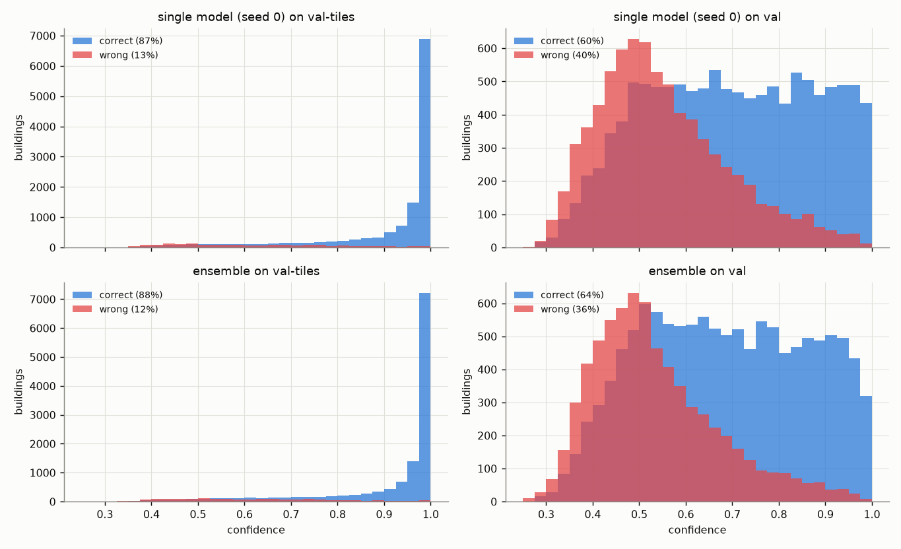

# Results (validation only)

Generated by `scripts/make_results.py` from `runs/`. **Every number here is on val-tiles or val. The test set (hurricane-michael, santa-rosa-wildfire) has not been loaded, evaluated or looked at**; `src/split.py` blocks it unless `--final` is passed.

- **val-tiles**: held-out spatial blocks of the six *training* disasters (14,718 buildings). Used for model selection and for fitting the temperature, so scores on it are optimistic.
- **val**: hurricane-florence and midwest-flooding, never trained on (19,099 buildings). Floods only, with few minor-damage and destroyed buildings (372 and 187), so its per-class numbers for those two classes are noisy.

> **val is used for model selection.** The checkpoint that is kept is the last epoch of the best 3-epoch stretch of the *mean of the val-tiles and val macro-F1* (`smoothed_score` in `src/train.py`), and the settings below were compared on val. val scores are therefore not an untouched estimate for a new disaster: they are somewhat optimistic. The only untouched data is the test set.

Un-classified buildings are dropped (`docs/data_decisions.md`). Recall of a class = share of its buildings that were predicted as that class. Macro-F1 = plain average of the four per-class F1 scores. **'a ± b (c-d)'** = mean, standard deviation and range over the seeds of a setting; with 3 seeds the standard deviation is itself rough.

## 1. Baselines

What you get without looking at any image. Class shares in train: no-damage 73.8%, minor-damage 8.8%, major-damage 9.4%, destroyed 8.0%.

| split | baseline | accuracy | macro-F1 | recall no-dmg | recall minor | recall major | recall destr. |
|---|---|---|---|---|---|---|---|
| val-tiles | majority class (no-damage) | 0.809 | 0.224 | 1.000 | 0.000 | 0.000 | 0.000 |
| val-tiles | random, weighted by train class frequency | 0.615 | 0.248 | 0.739 | 0.088 | 0.094 | 0.080 |
| val | majority class (no-damage) | 0.878 | 0.234 | 1.000 | 0.000 | 0.000 | 0.000 |
| val | random, weighted by train class frequency | 0.660 | 0.236 | 0.739 | 0.088 | 0.094 | 0.081 |

Majority-class accuracy is high because most buildings are undamaged; its macro-F1 shows it is useless. A model has to beat **both** numbers.

## 2. Settings compared: mean ± spread over seeds

Every setting is the stack ResNet-18 with the strong augmentation, trained with seeds 0, 1, 2; only the preprocessing differs (`src/dataset.py`):

- **per-image normalisation**: each image is shifted and scaled by its own channel means and standard deviations instead of ImageNet's fixed ones, which removes overall brightness, contrast and colour cast;
- **histogram matching**: the post image is recoloured so that each channel has the pre image's distribution of values.

Single models (each seed on its own):

| setting | runs | val-tiles accuracy | val-tiles macro-F1 | val accuracy | val macro-F1 |
|---|---|---|---|---|---|
| base: stack, strong augmentation | `stack_aug_s*` (3 seeds) | 0.870 ± 0.001 (0.869-0.872) | 0.694 ± 0.002 (0.693-0.697) | 0.617 ± 0.021 (0.604-0.641) | 0.304 ± 0.005 (0.299-0.310) |
| base + per-image normalisation | `stack_aug_pernorm_s*` (3 seeds) | 0.866 ± 0.000 (0.866-0.866) | 0.681 ± 0.002 (0.679-0.683) | 0.497 ± 0.030 (0.477-0.531) | 0.248 ± 0.011 (0.237-0.260) |
| base + post colours histogram-matched to pre | `stack_aug_histmatch_s*` (3 seeds) | 0.862 ± 0.001 (0.860-0.863) | 0.672 ± 0.001 (0.672-0.673) | 0.571 ± 0.020 (0.549-0.586) | 0.271 ± 0.009 (0.261-0.279) |

Ensemble of each setting's seeds (probabilities averaged; one number per setting, so no spread):

| setting | val-tiles accuracy | val-tiles macro-F1 | val accuracy | val macro-F1 |
|---|---|---|---|---|
| base: stack, strong augmentation | 0.876 | 0.705 | 0.640 | 0.313 |
| base + per-image normalisation | 0.871 | 0.690 | 0.512 | 0.246 |
| base + post colours histogram-matched to pre | 0.867 | 0.683 | 0.590 | 0.276 |

- **base + per-image normalisation** against the base, on val: macro-F1 -0.056, accuracy -0.120 (difference of means); on val-tiles macro-F1 -0.013. The seeds' val macro-F1 ranges do not overlap and their val accuracy ranges do not overlap: with 3 and 3 seeds, that is a difference worth taking seriously.
- **base + post colours histogram-matched to pre** against the base, on val: macro-F1 -0.034, accuracy -0.046 (difference of means); on val-tiles macro-F1 -0.022. The seeds' val macro-F1 ranges do not overlap and their val accuracy ranges do not overlap: with 3 and 3 seeds, that is a difference worth taking seriously.

For scale: always answering no-damage scores 0.878 accuracy on val. The best setting's mean val accuracy is 0.617 (`stack_aug`), still below it.

## 3. Does uncertainty flag failure on val?

The triage idea needs the model to be *less sure when it is wrong*, most of all on a disaster it has not seen. Three ways to check, for the single model (temperature-scaled top probability; mean ± spread over seeds) and for the ensemble (averaged probabilities, with its own temperature):

- **AUROC**: the chance that a correct prediction has a higher confidence than a wrong one. 0.5 = confidence says nothing; 1 = perfect separation.
- **errors in the least-confident 20% / 50%**: of all the mistakes, the share that sits among the least confident 20% (or 50%) of predictions. Unrelated confidence would give 20% (or 50%).
- **mean confidence** on val against val-tiles, next to accuracy: does the model *know* it is on unfamiliar ground? Confidence should fall when accuracy falls.

| setting | split | model | accuracy | mean confidence | AUROC | errors in least-confident 20% | errors in least-confident 50% |
|---|---|---|---|---|---|---|---|
| base: stack, strong augmentation | val-tiles | single (3 seeds) | 0.870 ± 0.001 (0.869-0.872) | 0.874 ± 0.001 (0.874-0.876) | 0.901 ± 0.004 (0.897-0.904) | 0.735 ± 0.018 (0.714-0.746) | 0.969 ± 0.001 (0.968-0.970) |
| base: stack, strong augmentation | val-tiles | ensemble | 0.876 | 0.878 | 0.899 | 0.732 | 0.969 |
| base: stack, strong augmentation | val | single (3 seeds) | 0.617 ± 0.021 (0.604-0.641) | 0.644 ± 0.006 (0.638-0.651) | 0.739 ± 0.008 (0.732-0.748) | 0.331 ± 0.016 (0.321-0.349) | 0.725 ± 0.016 (0.713-0.743) |
| base: stack, strong augmentation | val | ensemble | 0.640 | 0.630 | 0.746 | 0.345 | 0.740 |
| base + per-image normalisation | val-tiles | single (3 seeds) | 0.866 ± 0.000 (0.866-0.866) | 0.870 ± 0.002 (0.868-0.872) | 0.902 ± 0.004 (0.898-0.906) | 0.731 ± 0.013 (0.717-0.742) | 0.969 ± 0.002 (0.968-0.971) |
| base + per-image normalisation | val-tiles | ensemble | 0.871 | 0.875 | 0.905 | 0.737 | 0.973 |
| base + per-image normalisation | val | single (3 seeds) | 0.497 ± 0.030 (0.477-0.531) | 0.648 ± 0.003 (0.646-0.651) | 0.679 ± 0.009 (0.669-0.687) | 0.264 ± 0.012 (0.256-0.277) | 0.627 ± 0.016 (0.613-0.645) |
| base + per-image normalisation | val | ensemble | 0.512 | 0.631 | 0.681 | 0.266 | 0.629 |
| base + post colours histogram-matched to pre | val-tiles | single (3 seeds) | 0.862 ± 0.001 (0.860-0.863) | 0.869 ± 0.000 (0.869-0.869) | 0.904 ± 0.001 (0.903-0.906) | 0.719 ± 0.006 (0.713-0.723) | 0.973 ± 0.002 (0.970-0.974) |
| base + post colours histogram-matched to pre | val-tiles | ensemble | 0.867 | 0.874 | 0.905 | 0.730 | 0.974 |
| base + post colours histogram-matched to pre | val | single (3 seeds) | 0.571 ± 0.020 (0.549-0.586) | 0.654 ± 0.003 (0.652-0.658) | 0.728 ± 0.008 (0.719-0.733) | 0.305 ± 0.010 (0.293-0.312) | 0.696 ± 0.021 (0.673-0.709) |
| base + post colours histogram-matched to pre | val | ensemble | 0.590 | 0.643 | 0.735 | 0.315 | 0.709 |

**Reading it, for the base setting (`stack_aug`), single model:**

- From val-tiles to val, accuracy falls by 0.253 and mean confidence by 0.231. Confidence falls by about as much as accuracy: the model does register that val is harder.
- AUROC on val is 0.739 against 0.901 on val-tiles: confidence still ranks mistakes below correct answers on val, but much less sharply.
- The least-confident 20% of val predictions hold 33% of the val mistakes, and the least-confident 50% hold 72% (on val-tiles: 73% and 97%).
- The ensemble on val: AUROC 0.746 (single models 0.732-0.748), 35% of mistakes in the least-confident 20%, 74% in the least-confident 50%. It is within the range of its members: no clear gain in flagging failure.

**Short answer:** partly. On val the confidence carries real information about which predictions are wrong (AUROC well above 0.5, mistakes concentrated among the least confident), but far less than on val-tiles, and with so many mistakes on val a large share of them still sits among confident predictions. Section 5 turns this into coverage and inspection numbers.

## 4. Why is val worse? (gap diagnosis)

Two diagnostics, input swaps (which of the two images carries the shift) and colour statistics per disaster, are in **`docs/gap_diagnosis.md`** (`scripts/gap_diagnosis.py`). The two fixes in section 2 are the direct test of the colour explanation.

## 5. Calibration and triage (`stack_aug`)

Single model = `stack_aug_s0`; ensemble = `stack_aug_s0`, `stack_aug_s1`, `stack_aug_s2`.

### Calibration

Temperature scaling (`src/calibrate.py`): one number T divides the logits, fitted on val-tiles. Single model: **T = 1.287** (above 1: over-confident, made less sure); ensemble: T = 1.215. ECE = average gap between confidence and accuracy (15 bins); NLL = negative log-likelihood. Scaling never changes the predicted class.

| split | temperature scaling | ECE | NLL | mean confidence | accuracy |
|---|---|---|---|---|---|
| val-tiles | before | 0.0327 | 0.3515 | 0.9030 | 0.8707 |
| val-tiles | after | 0.0106 | 0.3394 | 0.8736 | 0.8707 |
| val | before | 0.0903 | 0.9598 | 0.6938 | 0.6036 |
| val | after | 0.0348 | 0.9208 | 0.6383 | 0.6036 |

All methods (AURC = area under the risk-coverage curve, lower is better):

| split | method | accuracy | macro-F1 | ECE | AURC |
|---|---|---|---|---|---|
| val-tiles | max prob (raw) | 0.8707 | 0.6929 | 0.0327 | 0.0245 |
| val-tiles | max prob (temp. scaled) | 0.8707 | 0.6929 | 0.0106 | 0.0245 |
| val-tiles | ensemble of 3 | 0.8759 | 0.7052 | 0.0246 | 0.0228 |
| val-tiles | ensemble of 3 (temp. scaled) | 0.8759 | 0.7052 | 0.0100 | 0.0229 |
| val | max prob (raw) | 0.6036 | 0.3035 | 0.0903 | 0.2240 |
| val | max prob (temp. scaled) | 0.6036 | 0.3035 | 0.0348 | 0.2221 |
| val | ensemble of 3 | 0.6398 | 0.3132 | 0.0327 | 0.1915 |
| val | ensemble of 3 (temp. scaled) | 0.6398 | 0.3132 | 0.0297 | 0.1900 |

The ensemble next to each of its members (each member with its own temperature):

| model | epoch kept | val-tiles accuracy | val-tiles macro-F1 | val-tiles AURC | val-tiles accuracy at 50% coverage | val accuracy | val macro-F1 | val AURC | val accuracy at 50% coverage |
|---|---|---|---|---|---|---|---|---|---|
| stack_aug_s0 | 10 of 10 | 0.871 | 0.693 | 0.025 | 0.992 | 0.604 | 0.304 | 0.222 | 0.773 |
| stack_aug_s1 | 10 of 10 | 0.872 | 0.697 | 0.023 | 0.992 | 0.641 | 0.310 | 0.190 | 0.815 |
| stack_aug_s2 | 9 of 10 | 0.869 | 0.693 | 0.024 | 0.992 | 0.607 | 0.299 | 0.218 | 0.779 |
| ensemble |  | 0.876 | 0.705 | 0.023 | 0.992 | 0.640 | 0.313 | 0.190 | 0.813 |

### Triage

**Auto-accept view.** Keep the most confident X% of predictions (`src/triage.py`), send the rest to a person. Accuracy on the accepted buildings:

| split / method | 100% | 90% | 80% | 70% | 50% |
|---|---|---|---|---|---|
| val-tiles / max prob (raw) | 0.871 | 0.916 | 0.954 | 0.980 | 0.991 |
| val-tiles / max prob (temp. scaled) | 0.871 | 0.917 | 0.954 | 0.980 | 0.992 |
| val-tiles / ensemble of 3 | 0.876 | 0.921 | 0.959 | 0.982 | 0.993 |
| val-tiles / ensemble of 3 (temp. scaled) | 0.876 | 0.921 | 0.958 | 0.982 | 0.992 |
| val / max prob (raw) | 0.604 | 0.633 | 0.662 | 0.694 | 0.770 |
| val / max prob (temp. scaled) | 0.604 | 0.633 | 0.664 | 0.696 | 0.773 |
| val / ensemble of 3 | 0.640 | 0.672 | 0.706 | 0.740 | 0.810 |
| val / ensemble of 3 (temp. scaled) | 0.640 | 0.672 | 0.705 | 0.741 | 0.813 |

Macro-F1 on the accepted buildings (the accepted set is mostly easy, no-damage buildings; rare classes get rarer in it, so this number is noisier and can fall while accuracy rises):

| split / method | 100% | 90% | 80% | 70% | 50% |
|---|---|---|---|---|---|
| val-tiles / max prob (raw) | 0.693 | 0.760 | 0.813 | 0.831 | 0.691 |
| val-tiles / max prob (temp. scaled) | 0.693 | 0.762 | 0.814 | 0.829 | 0.688 |
| val-tiles / ensemble of 3 | 0.705 | 0.771 | 0.824 | 0.824 | 0.699 |
| val-tiles / ensemble of 3 (temp. scaled) | 0.705 | 0.771 | 0.825 | 0.824 | 0.695 |
| val / max prob (raw) | 0.304 | 0.316 | 0.326 | 0.336 | 0.356 |
| val / max prob (temp. scaled) | 0.304 | 0.316 | 0.328 | 0.339 | 0.361 |
| val / ensemble of 3 | 0.313 | 0.327 | 0.339 | 0.349 | 0.371 |
| val / ensemble of 3 (temp. scaled) | 0.313 | 0.327 | 0.339 | 0.350 | 0.377 |

**Inspection-budget view.** Inspectors can visit K% of the buildings. Share of the truly damaged buildings (minor, major or destroyed) among those visited. 'Most likely damaged' ranks by 1 - P(no-damage); 'least confident' ranks by confidence. Random visits reach K%.

| split | method | policy | K=10% | K=20% | K=30% | K=40% | K=50% |
|---|---|---|---|---|---|---|---|
| val-tiles | max prob (temp. scaled) | least confident first | 28.0% | 53.6% | 75.1% | 86.2% | 91.3% |
| val-tiles | max prob (temp. scaled) | most likely damaged first | 47.1% | 78.3% | 94.0% | 97.3% | 98.3% |
| val-tiles | ensemble of 3 (temp. scaled) | least confident first | 28.6% | 53.2% | 75.6% | 87.2% | 91.9% |
| val-tiles | ensemble of 3 (temp. scaled) | most likely damaged first | 47.4% | 79.2% | 94.4% | 97.4% | 98.4% |
| val | max prob (temp. scaled) | least confident first | 17.6% | 31.9% | 43.8% | 54.8% | 64.4% |
| val | max prob (temp. scaled) | most likely damaged first | 30.4% | 46.5% | 59.4% | 69.0% | 76.8% |
| val | ensemble of 3 (temp. scaled) | least confident first | 17.9% | 32.7% | 46.2% | 57.6% | 67.0% |
| val | ensemble of 3 (temp. scaled) | most likely damaged first | 28.4% | 46.7% | 59.9% | 69.9% | 77.8% |

In the chart, solid lines are 'most likely damaged first' and dashed lines 'least confident first'; colour is the method.

## 6. MC dropout: tried and set aside

MC dropout (20 forward passes with dropout left on, each pass temperature-scaled; confidence = mean of the passes' top probabilities, or minus the entropy of the averaged probabilities) was run once, on an earlier `stack_aug` seed-0 model. Its numbers next to the plain top probability of the same model:

| split | method | accuracy | macro-F1 | ECE | AURC | accuracy at 80% coverage | accuracy at 50% coverage |
|---|---|---|---|---|---|---|---|
| val-tiles | max prob (temp. scaled) | 0.8697 | 0.6933 | 0.0154 | 0.0238 | 0.9580 | 0.9930 |
| val-tiles | MC dropout (mean max prob) | 0.8695 | 0.6930 | 0.0156 | 0.0240 | 0.9580 | 0.9930 |
| val-tiles | MC dropout (entropy) | 0.8695 | 0.6930 | 0.0160 | 0.0244 | 0.9560 | 0.9930 |
| val | max prob (temp. scaled) | 0.6133 | 0.3079 | 0.0426 | 0.2022 | 0.6760 | 0.7950 |
| val | MC dropout (mean max prob) | 0.6143 | 0.3085 | 0.0423 | 0.2017 | 0.6770 | 0.7960 |
| val | MC dropout (entropy) | 0.6143 | 0.3085 | 0.0405 | 0.2021 | 0.6700 | 0.7930 |

It is practically identical to the plain top probability on every measure, at 20 times the prediction cost. The reason is structural: in these models dropout sits only in front of the last layer, so the 20 passes barely differ. It is therefore no longer part of the comparison. The code remains in `src/uncertainty.py` (`mc_dropout_probs`), tested; it would be worth revisiting only with dropout inside the backbone, which changes training.

## 7. Earlier single-run comparisons (recorded)

The first runs, kept for the record. They used the earlier selection rule (best single epoch of the mean macro-F1, no 3-epoch window); `siamese_s0` kept its weights by val-tiles macro-F1 alone, and its row is taken from its per-epoch log. Sanity check before any of this: the siamese model overfitted 256 training crops to 100% in 4 epochs.

| run | what | epoch kept | val-tiles acc | val-tiles macro-F1 | val acc | val macro-F1 |
|---|---|---|---|---|---|---|
| siamese_s0 | siamese, base augmentation | 10 | 0.880 | 0.704 | 0.483 | 0.256 |
| stack_s0 | stack, base augmentation | 4 of 7 | 0.871 | 0.685 | 0.676 | 0.297 |
| stack_aug_s0 | stack, strong augmentation | 9 of 10 | 0.870 | 0.693 | 0.613 | 0.308 |
| stack_aug_s1 | same, seed 1 | 9 of 10 | 0.870 | 0.693 | 0.657 | 0.310 |
| stack_aug_s2 | same, seed 2 | 4 of 7 | 0.862 | 0.669 | 0.761 | 0.337 |
| ensemble of those 3 | probabilities averaged |  | 0.875 | 0.700 | 0.709 | 0.331 |

What they showed: stack edged out siamese on the selection score (0.491 against 0.480), and the strong augmentation gave a mixed result against plain stack (val macro-F1 +0.011, val accuracy -0.063). Both were one run per setting, and the three `stack_aug` seeds differ by more than either gap, so neither comparison is settled.

## 8. All runs

Every run behind sections 2-5, at the epoch that was kept.

| run | epoch kept | val-tiles acc | val-tiles macro-F1 | val acc | val macro-F1 | smoothed selection score | loader workers | train s/epoch | RAM of this run, peak GB | RAM free, minimum GB | GPU peak GB (reserved) |
|---|---|---|---|---|---|---|---|---|---|---|---|
| stack_aug_s0 | 10 of 10 | 0.871 | 0.693 | 0.604 | 0.304 | 0.496 | 6 | 71 | 17.510 | 17.450 | 4.076 |
| stack_aug_s1 | 10 of 10 | 0.872 | 0.697 | 0.641 | 0.310 | 0.499 | 6 | 68 | 17.260 | 19.220 | 4.076 |
| stack_aug_s2 | 9 of 10 | 0.869 | 0.693 | 0.607 | 0.299 | 0.498 | 6 | 68 | 17.260 | 20.580 | 4.076 |
| stack_aug_pernorm_s0 | 10 of 10 | 0.866 | 0.679 | 0.483 | 0.247 | 0.461 | 6 | 82 | 17.510 | 17.560 | 4.076 |
| stack_aug_pernorm_s1 | 9 of 10 | 0.866 | 0.681 | 0.477 | 0.237 | 0.458 | 6 | 69 | 16.890 | 21.760 | 4.076 |
| stack_aug_pernorm_s2 | 9 of 10 | 0.866 | 0.683 | 0.531 | 0.260 | 0.471 | 6 | 64 | 16.890 | 21.360 | 4.076 |
| stack_aug_histmatch_s0 | 10 of 10 | 0.863 | 0.673 | 0.549 | 0.261 | 0.465 | 6 | 83 | 16.530 | 22.010 | 4.076 |
| stack_aug_histmatch_s1 | 10 of 10 | 0.860 | 0.672 | 0.578 | 0.279 | 0.471 | 6 | 87 | 16.530 | 21.270 | 4.076 |
| stack_aug_histmatch_s2 | 9 of 10 | 0.863 | 0.672 | 0.586 | 0.273 | 0.468 | 6 | 87 | 16.530 | 21.690 | 4.076 |

Per-epoch metrics and memory are in `runs/<run>/log.jsonl` (not in git).
