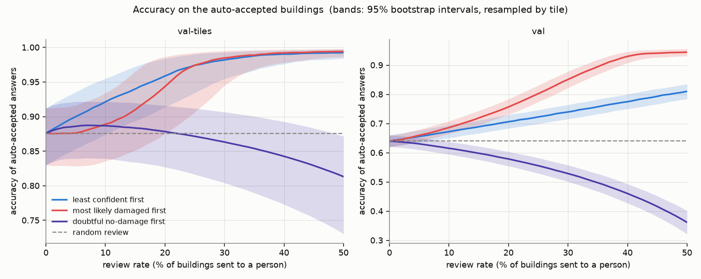
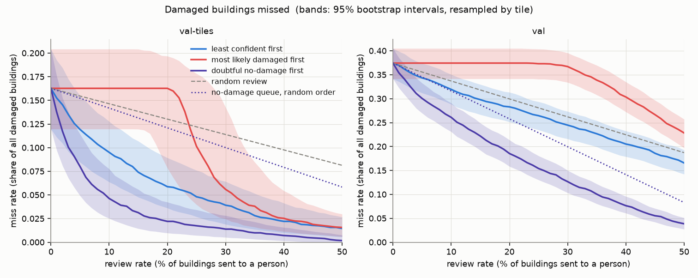

# Risk-coverage: what does sending buildings to a person buy? (validation only)

Written 2026-10-09. Model: the ensemble of the three base seeds (`stack_aug_s0..2`,
mean of their softmax probabilities). Data: the exported predictions for val-tiles and
val. **The test set was not touched.**

This first part is written by hand; the tables and plots further down are generated by
`scripts/risk_coverage.py`. If they are regenerated from other predictions, check this
text against them.

## The setup in four lines

- A person can review some share of the buildings (the **review rate**); the model's
  answer is accepted for the rest.
- Three ways to pick who is reviewed: **least confident first** (lowest top
  probability), **most likely damaged first** (highest 1 - P(no-damage)), and
  **doubtful no-damage first** (only buildings predicted no-damage are in the queue,
  highest 1 - P(no-damage) first; buildings predicted damaged go straight to the damage
  map, unreviewed). The third was added after the first two; see point 5.
- On the accepted rest: **accuracy**, **macro-F1**, and the **miss rate** = of all truly
  damaged buildings, the share that was accepted *and* called no-damage. Nobody looks
  at those; they are the costly mistake.
- Every number has a 95% interval from 1000 bootstrap resamples of whole tiles.

**val-tiles** = held-out tiles of the six training disasters (158 tiles). **val** = two
flood disasters the model never trained on (718 tiles).

## Reading

**1. On the training disasters (val-tiles), reviewing the least confident buildings
works well.** Reviewing 20% lifts the accuracy of the accepted answers from 0.876 to
0.959 and cuts the miss rate from 0.163 to 0.059: almost two thirds of the missed
damage is caught by looking at one building in five. At 30% review the accepted
answers are 98% right. Random review of 20% would leave the miss rate at 0.130; the
confidence ranking is 0.071 better than that (interval 0.043 to 0.098).

**2. On unseen disasters (val), the same recipe helps much less.** Reviewing 20% lifts
accuracy from 0.640 to 0.706 and cuts the miss rate from 0.374 to 0.283. But random
review of 20% would already cut it to 0.299. The confidence ranking beats random by
0.017 (interval 0.006 to 0.030): real, and small. Even at 50% review, 17% of the
damaged buildings are still accepted as no-damage (0.166), and the accepted answers
are 81% right. Put plainly: on val the model's doubt points at its mistakes in
general (accuracy does rise), but hardly at the *damaged buildings it calls fine*.
Those it tends to call fine with confidence.

**3. "Most likely damaged first" does not reduce misses at all until the review rate is
large.** This looks surprising and is the most useful thing in this analysis. The
buildings with the highest P(damaged) are the ones the model already *predicts* as
damaged. Reviewing them confirms or corrects a damage call; it cannot catch a building
the model called no-damage. The miss rate therefore stays exactly where it started
until the reviewers have worked through everything predicted damaged: about 22% of
buildings on val-tiles, about 36% on val (the model over-calls damage there). Only
then does it start falling. At 30% review on val the miss rate is 0.367 against 0.245
for least-confident-first.

**4. The high accuracy of "most likely damaged first" on val is mostly an illusion.**
It reaches 0.851 at 30% review and 0.944 at 50%, far above least-confident-first
(0.740, 0.810). But what is left to accept is then almost only buildings predicted
no-damage, and 88% of val is undamaged to begin with: always answering no-damage scores
0.878 on val. Macro-F1 on the accepted buildings shows it: it *falls* under this
policy (0.313 to 0.264 at 30%) because the accepted set has nearly stopped containing
correct damage calls. Accuracy alone would have picked the wrong policy here.

**5. The two policies answer different questions.** `docs/results.md` (inspection
budget) shows "most likely damaged first" *reaching* more damaged buildings per visit;
that is true and not in conflict with point 3. If the goal is "send inspectors where
damage is", rank by P(damaged). If the goal is "make sure the accepted pile does not
hide damage", rank by confidence, or better, only review buildings that would
otherwise be accepted as no-damage. That third policy is "doubtful no-damage first":

**5a. Doubtful no-damage first is clearly the best of the three at catching misses, on
both parts.**

| review rate | val-tiles: least confident | val-tiles: doubtful no-damage | val: least confident | val: doubtful no-damage | val: random review |
|---|---|---|---|---|---|
| 10% | 0.095 | 0.046 | 0.319 | 0.261 | 0.337 |
| 20% | 0.059 | 0.022 | 0.283 | 0.185 | 0.299 |
| 30% | 0.039 | 0.014 | 0.245 | 0.127 | 0.262 |

(miss rates; intervals are in the tables below.) On val, reviewing 20% now halves the
missed damage (0.374 to 0.185, interval 0.158 to 0.214) where least-confident-first
managed 0.283. The gain over least-confident-first is 0.097 (interval 0.083 to 0.110),
far outside the noise. At 50% review the miss rate on val is 0.039 against 0.166.

**5b. Both halves of the idea contribute.** Restricting review to buildings predicted
no-damage helps even with no ranking at all, because no review is spent on buildings
that cannot be misses: random order within that queue gives 0.257 on val at 20%
(plain random: 0.299). Ordering the queue by P(damaged) takes it from 0.257 to 0.185
(interval of that step: 0.055 to 0.088). So unlike plain confidence, P(damaged) *does*
rank the hidden damage well on val, once it is asked about the right buildings.

**5c. The price: the damage map is not checked, and on val it is mostly false alarms.**
Under this policy every building predicted damaged is accepted as it is. On val-tiles
that is 3,244 buildings, of which 73% are truly damaged. On val it is 6,825 buildings
(36% of all), of which only 21% are truly damaged: about 5,400 undamaged buildings shown
as damaged. That is why the accuracy of the accepted answers *falls* under this policy
(val: 0.640 with nobody reviewed, 0.579 at 20%): reviewers remove mostly-correct
no-damage calls from the accepted pile and leave the wrong damage calls in it. Whether
that is acceptable depends on what a false alarm costs. If it costs a wasted site visit
and a miss costs an unhelped household, this is the right trade; the numbers here do
not decide that.

**5d. What it does not catch.** Damage called by the wrong name (minor shown as
destroyed, or the reverse) is on the map and never reviewed. The miss rate as defined
here does not count it.

**6. How sure are these numbers?** val-tiles has only 158 tiles, and damage is
concentrated on few of them, so its intervals are wide: the accuracy with nobody
reviewed is 0.876 with an interval of 0.830 to 0.912. val has 718 tiles and tighter
intervals (0.620 to 0.660). The comparisons between policies are much tighter than the
single numbers, because both policies are scored on the same resampled tiles. None of
the intervals says anything about a third unseen disaster: val is two floods.

**7. In short.** Reviewing by plain confidence is a strong tool where the model is
already good and a weak one where it is not. Aiming the review at buildings called
no-damage, most doubtful first, is much better at the thing that matters most: on the
unseen disasters it halves the missed damage at a 20% review rate. It does so by
leaving the over-full damage map unchecked, and 18.5% of damaged buildings on val are
still missed at that rate.

## Resume bullet

No resume bullet template was found in this repository, so the slots below are a guess
at its shape; the numbers are real and each says which part it is from.

Template with the slots filled (review rate 20%, least confident first):

> Built an uncertainty-aware triage pipeline for building-damage classification from
> pre/post satellite imagery (xBD, 4 classes, 3-model ResNet-18 ensemble): routing the
> 20% least-confident buildings to human review raised accuracy on auto-accepted
> predictions from 64.0% to 70.6% and cut missed damage from 37.4% to 28.3% on two
> held-out disasters **[val]**, and from 87.6% to 95.9% accuracy and 16.3% to 5.9%
> missed damage on held-out tiles of the training disasters **[val-tiles]**; 95%
> confidence intervals by tile-level bootstrap.

| slot | value | part |
|---|---|---|
| accuracy, no review | 64.0% (62.0-66.0) | val |
| accuracy of accepted, 20% review | 70.6% (68.4-73.0) | val |
| miss rate, no review | 37.4% (34.2-40.5) | val |
| miss rate, 20% review | 28.3% (25.1-31.3) | val |
| miss rate, 20% review at random | 29.9% | val |
| accuracy, no review -> 20% review | 87.6% -> 95.9% | val-tiles |
| miss rate, no review -> 20% review | 16.3% -> 5.9% | val-tiles |

The review policy added later (doubtful no-damage first) gives a better val number, to
be quoted together with its cost:

> ...designed a review queue targeting predicted-undamaged buildings ranked by damage
> probability, halving missed damage on unseen disasters (37.4% to 18.5% at a 20%
> review rate, vs 28.3% for confidence ranking and 29.9% for random review) **[val]**.

| slot | value | part |
|---|---|---|
| miss rate, 20% review, doubtful no-damage first | 18.5% (15.8-21.4) | val |
| share of predicted-damaged buildings that are truly damaged (unreviewed) | 21% | val |
| miss rate, 20% review, doubtful no-damage first | 2.2% (1.0-4.2) | val-tiles |

Be ready for the follow-up on the confidence-ranking bullet: on val its miss-rate gain
over random review is 1.7 points. A version that leads with the honest finding is the stronger bullet:

> ...showed that confidence-based review cuts missed damage by 64% on seen disaster
> types **[val-tiles]** but only 24% on unseen disasters **[val]**, barely better than
> random review, quantifying the limits of uncertainty estimates under distribution
> shift (tile-level bootstrap CIs).

(64% = from 16.3% to 5.9%; 24% = from 37.4% to 28.3%; both at 20% review.)

## How to explain this in an interview

**The 30-second version.** "The model classifies building damage from before/after
satellite images. It will be wrong sometimes, so I asked: if people can check 20% of
the buildings, which 20%, and how good is what is left? I ranked buildings by the
model's own confidence, sent the least confident to review, and measured accuracy and
missed damage on the rest. On disasters like the training ones it works well: missed
damage drops by almost two thirds. On disasters the model has never seen it barely
beats picking buildings at random. So the uncertainty is useful, but it does not
protect you from distribution shift."

**Terms, in one line each.**

- *Risk-coverage curve*: accept only the predictions the model is surest about;
  coverage is how many you accept, risk is how many of those are wrong. A good
  confidence score makes risk fall as coverage shrinks.
- *Ensemble*: three copies of the model trained with different random seeds; average
  their probabilities.
- *Miss rate*: damaged buildings that are both auto-accepted and labelled undamaged,
  as a share of all damaged buildings. Chosen because that mistake costs the most.
- *Bootstrap by tile*: to get error bars, redraw the dataset with replacement 1000
  times and recompute. Whole image tiles are redrawn, not single buildings, because
  buildings on one tile are not independent.

**Questions to expect, and honest answers.**

- *Why not just report accuracy?* 88% of val is undamaged; a model that always says
  "no damage" is 88% accurate and misses every damaged building. Point 4 above is a
  concrete case where accuracy and macro-F1 moved in opposite directions.
- *Why resample tiles?* Neighbouring buildings share image, lighting and damage.
  Treating 19,099 buildings as 19,099 independent samples would make the intervals
  too narrow. There are 718 tiles in val; that is closer to the real sample size.
- *Why did "most likely damaged first" not reduce misses?* It reviews buildings the
  model already calls damaged. A miss is a building the model calls undamaged. The
  policy never looks at those until it has run out of predicted damage.
- *Why is val so much worse?* Different disasters: the model learned what damage looks
  like in six disasters and val is two floods it never saw (`docs/gap_diagnosis.md`).
  Calibration is fine there (`docs/calibration_results.md`); accuracy is not.
- *So what did you do about it?* Changed the queue: only buildings predicted undamaged
  are reviewed, most doubtful first; predicted damage goes straight to the map. On the
  unseen disasters that halves missed damage at a 20% review rate. The cost is that the
  map is unchecked, and there only one flagged building in five is really damaged.
- *What would you do next?* Decide the trade between false alarms and misses with
  someone who knows what each costs; a model that compares pre and post rather than
  reading the post image alone; and no claim about new disasters until the held-out
  test disasters are opened, once, at the end.
- *What are the limits of this analysis?* Validation data that also influenced model
  selection, so val is somewhat optimistic; two unseen disasters, both floods; labels
  with known noise (`docs/label_noise.md`); intervals cover tile sampling, not a new
  disaster.

<!-- section:tables:start -->
## Tables

Generated by `scripts/risk_coverage.py` from `outputs/predictions/` (runs: `stack_aug_s0`, `stack_aug_s1`, `stack_aug_s2`; mean softmax over the seeds, no temperature). Each cell: value (95% interval). Intervals: 1000 bootstrap resamples of whole tiles, percentile method. All three numbers are computed on the auto-accepted buildings; the miss rate is their undetected damage as a share of all truly damaged buildings in the part.

### val-tiles

14,718 buildings on 158 tiles; 2,808 truly damaged (19.1%); 3,244 predicted damaged (22.0%).

| review rate | who is reviewed | accuracy | macro-F1 | miss rate |
|---|---|---|---|---|
| 0% | nobody | 0.876 (0.830-0.912) | 0.705 (0.645-0.755) | 0.163 (0.120-0.204) |
| 10% | least confident first | 0.921 (0.874-0.955) | 0.771 (0.696-0.827) | 0.095 (0.064-0.128) |
| 10% | most likely damaged first | 0.889 (0.836-0.934) | 0.568 (0.481-0.644) | 0.163 (0.120-0.204) |
| 10% | doubtful no-damage first | 0.887 (0.839-0.922) | 0.730 (0.667-0.779) | 0.046 (0.025-0.078) |
| 20% | least confident first | 0.959 (0.914-0.984) | 0.824 (0.741-0.878) | 0.059 (0.036-0.089) |
| 20% | most likely damaged first | 0.943 (0.876-0.986) | 0.399 (0.246-0.528) | 0.163 (0.079-0.197) |
| 20% | doubtful no-damage first | 0.878 (0.827-0.916) | 0.735 (0.672-0.784) | 0.022 (0.010-0.042) |
| 30% | least confident first | 0.982 (0.954-0.993) | 0.824 (0.676-0.885) | 0.039 (0.019-0.064) |
| 30% | most likely damaged first | 0.985 (0.945-0.995) | 0.248 (0.244-0.277) | 0.056 (0.025-0.143) |
| 30% | doubtful no-damage first | 0.863 (0.804-0.906) | 0.735 (0.672-0.786) | 0.014 (0.005-0.028) |

Differences below are computed on the same tiles in every resample; an interval that excludes 0 means the difference is not just tile-to-tile noise.

Most likely damaged first minus least confident first:

| review rate | accuracy | macro-F1 | miss rate |
|---|---|---|---|
| 10% | -0.032 (-0.043 to -0.018) | -0.203 (-0.272 to -0.137) | +0.068 (+0.048 to +0.088) |
| 20% | -0.015 (-0.049 to +0.007) | -0.425 (-0.621 to -0.274) | +0.104 (+0.030 to +0.126) |
| 30% | +0.003 (-0.015 to +0.008) | -0.576 (-0.637 to -0.424) | +0.017 (+0.003 to +0.090) |

Doubtful no-damage first minus least confident first:

| review rate | accuracy | macro-F1 | miss rate |
|---|---|---|---|
| 10% | -0.035 (-0.041 to -0.026) | -0.041 (-0.061 to -0.020) | -0.049 (-0.067 to -0.031) |
| 20% | -0.080 (-0.096 to -0.063) | -0.089 (-0.121 to -0.045) | -0.037 (-0.056 to -0.021) |
| 30% | -0.119 (-0.156 to -0.083) | -0.089 (-0.143 to +0.039) | -0.025 (-0.044 to -0.010) |

Least confident first minus random review (negative miss rate = fewer misses than random):

| review rate | accuracy | miss rate |
|---|---|---|
| 10% | +0.045 (+0.040 to +0.050) | -0.051 (-0.070 to -0.034) |
| 20% | +0.083 (+0.068 to +0.093) | -0.071 (-0.098 to -0.043) |
| 30% | +0.106 (+0.077 to +0.130) | -0.075 (-0.103 to -0.048) |

Most likely damaged first minus random review (negative miss rate = fewer misses than random):

| review rate | accuracy | miss rate |
|---|---|---|
| 10% | +0.013 (+0.003 to +0.026) | +0.016 (+0.012 to +0.020) |
| 20% | +0.068 (+0.033 to +0.091) | +0.033 (-0.049 to +0.039) |
| 30% | +0.109 (+0.079 to +0.135) | -0.058 (-0.095 to +0.030) |

Doubtful no-damage first minus random review (negative miss rate = fewer misses than random):

| review rate | accuracy | miss rate |
|---|---|---|
| 10% | +0.011 (+0.003 to +0.020) | -0.100 (-0.130 to -0.070) |
| 20% | +0.003 (-0.009 to +0.013) | -0.108 (-0.137 to -0.077) |
| 30% | -0.013 (-0.030 to +0.001) | -0.100 (-0.127 to -0.072) |

Doubtful no-damage first minus the same queue reviewed in random order (what the ordering adds on top of restricting review to predicted no-damage):

| review rate | miss rate |
|---|---|
| 10% | -0.096 (-0.125 to -0.066) |
| 20% | -0.099 (-0.127 to -0.070) |
| 30% | -0.086 (-0.111 to -0.061) |

### val

19,099 buildings on 718 tiles; 2,329 truly damaged (12.2%); 6,825 predicted damaged (35.7%).

| review rate | who is reviewed | accuracy | macro-F1 | miss rate |
|---|---|---|---|---|
| 0% | nobody | 0.640 (0.620-0.660) | 0.313 (0.295-0.333) | 0.374 (0.342-0.405) |
| 10% | least confident first | 0.672 (0.651-0.695) | 0.327 (0.304-0.349) | 0.319 (0.288-0.351) |
| 10% | most likely damaged first | 0.686 (0.665-0.709) | 0.279 (0.265-0.292) | 0.374 (0.342-0.405) |
| 10% | doubtful no-damage first | 0.615 (0.595-0.637) | 0.313 (0.293-0.334) | 0.261 (0.231-0.291) |
| 20% | least confident first | 0.706 (0.684-0.730) | 0.339 (0.315-0.363) | 0.283 (0.251-0.313) |
| 20% | most likely damaged first | 0.757 (0.731-0.784) | 0.269 (0.258-0.284) | 0.374 (0.342-0.405) |
| 20% | doubtful no-damage first | 0.579 (0.554-0.604) | 0.308 (0.287-0.330) | 0.185 (0.158-0.214) |
| 30% | least confident first | 0.740 (0.716-0.764) | 0.349 (0.322-0.375) | 0.245 (0.216-0.273) |
| 30% | most likely damaged first | 0.851 (0.822-0.878) | 0.264 (0.246-0.286) | 0.367 (0.334-0.396) |
| 30% | doubtful no-damage first | 0.529 (0.501-0.558) | 0.299 (0.276-0.322) | 0.127 (0.103-0.150) |

Differences below are computed on the same tiles in every resample; an interval that excludes 0 means the difference is not just tile-to-tile noise.

Most likely damaged first minus least confident first:

| review rate | accuracy | macro-F1 | miss rate |
|---|---|---|---|
| 10% | +0.014 (+0.008 to +0.020) | -0.048 (-0.066 to -0.032) | +0.055 (+0.045 to +0.065) |
| 20% | +0.051 (+0.039 to +0.061) | -0.070 (-0.093 to -0.045) | +0.091 (+0.080 to +0.106) |
| 30% | +0.111 (+0.096 to +0.124) | -0.086 (-0.119 to -0.054) | +0.122 (+0.105 to +0.137) |

Doubtful no-damage first minus least confident first:

| review rate | accuracy | macro-F1 | miss rate |
|---|---|---|---|
| 10% | -0.057 (-0.061 to -0.052) | -0.014 (-0.020 to -0.007) | -0.058 (-0.069 to -0.049) |
| 20% | -0.127 (-0.134 to -0.120) | -0.031 (-0.040 to -0.021) | -0.097 (-0.110 to -0.083) |
| 30% | -0.211 (-0.221 to -0.201) | -0.050 (-0.062 to -0.036) | -0.118 (-0.132 to -0.104) |

Least confident first minus random review (negative miss rate = fewer misses than random):

| review rate | accuracy | miss rate |
|---|---|---|
| 10% | +0.033 (+0.029 to +0.035) | -0.018 (-0.027 to -0.008) |
| 20% | +0.066 (+0.061 to +0.071) | -0.017 (-0.030 to -0.006) |
| 30% | +0.100 (+0.094 to +0.106) | -0.017 (-0.033 to -0.004) |

Most likely damaged first minus random review (negative miss rate = fewer misses than random):

| review rate | accuracy | miss rate |
|---|---|---|
| 10% | +0.046 (+0.040 to +0.052) | +0.037 (+0.034 to +0.041) |
| 20% | +0.117 (+0.106 to +0.127) | +0.075 (+0.068 to +0.081) |
| 30% | +0.211 (+0.196 to +0.223) | +0.105 (+0.092 to +0.114) |

Doubtful no-damage first minus random review (negative miss rate = fewer misses than random):

| review rate | accuracy | miss rate |
|---|---|---|
| 10% | -0.025 (-0.028 to -0.020) | -0.076 (-0.090 to -0.064) |
| 20% | -0.061 (-0.068 to -0.054) | -0.114 (-0.129 to -0.098) |
| 30% | -0.111 (-0.122 to -0.100) | -0.135 (-0.152 to -0.119) |

Doubtful no-damage first minus the same queue reviewed in random order (what the ordering adds on top of restricting review to predicted no-damage):

| review rate | miss rate |
|---|---|
| 10% | -0.055 (-0.069 to -0.043) |
| 20% | -0.072 (-0.088 to -0.055) |
| 30% | -0.073 (-0.089 to -0.057) |

### Plots

The dashed line is what reviewing buildings at random would give; the dotted line is random review within the predicted-no-damage queue. Every review rate from 0 to 50% is in `outputs/risk_coverage/curves.csv` (not in git).
<!-- section:tables:end -->
