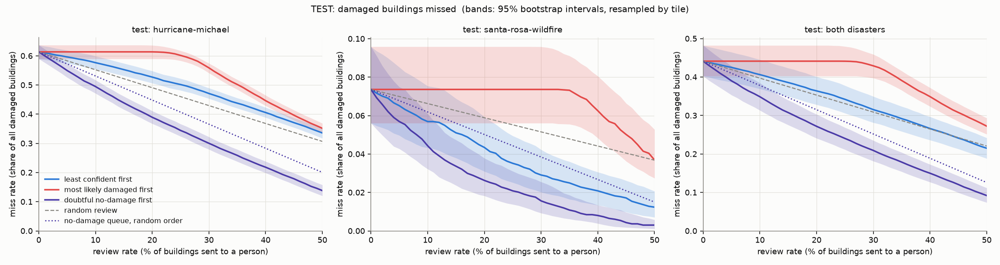
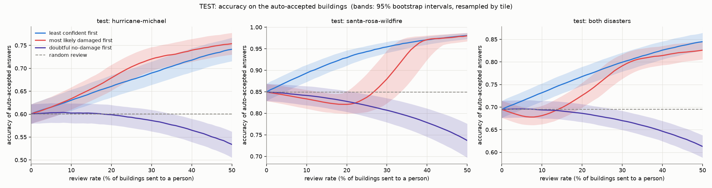

# Test results: the final held-out evaluation

Run once, on 2026-10-10, under `docs/test_protocol.md` (committed before the test set
was touched, commit `14cfb0e`; evaluation code committed before the export, `b99969e`).
The export ran one time and wrote `TEST_EVALUATION.lock`; it did not crash and was not
repeated. Nothing about the models, the queue or the review rate was changed after
these numbers were seen, and nothing will be: **these are the final numbers.**

The text down to "Tables" is written by hand. The tables and plots are generated by
`scripts/test_results.py`; the last section is exploratory and says so.

## What was evaluated

- The ensemble of the three base models (`stack_aug`, seeds 0-2), mean softmax, no
  temperature scaling.
- The review queue "doubtful no-damage first": only buildings predicted no-damage are
  reviewed, highest 1 - P(no-damage) first; predicted damage goes to the map unchecked.
- Headline review rate 20%.
- Test = hurricane-michael (28,056 buildings, 426 tiles) and santa-rosa-wildfire
  (17,111 buildings, 291 tiles); 45,167 buildings together. Neither disaster was used
  for training, for choosing checkpoints or for any decision in this project.

## The headline

**Missed-damage rate** = of all truly damaged buildings, the share that nobody reviews
and the model calls no-damage. Brackets: 95% intervals, 1000 bootstrap resamples of
whole tiles.

| | hurricane-michael | santa-rosa-wildfire | both |
|---|---|---|---|
| nobody reviewed | 0.614 (0.590-0.637) | 0.074 (0.056-0.096) | 0.441 (0.403-0.482) |
| 20% reviewed at random | 0.491 | 0.059 | 0.353 |
| 20%: the queue in random order | 0.449 (0.427-0.469) | 0.050 (0.038-0.067) | 0.315 (0.283-0.349) |
| **20%: doubtful no-damage first** | **0.390 (0.368-0.411)** | **0.026 (0.018-0.038)** | **0.272 (0.241-0.303)** |

On the accepted buildings at 20% review: accuracy 0.686 (0.667-0.707) and macro-F1
0.512 (0.499-0.524) for both disasters together. Of the buildings the model predicts as
damaged, 59.3% (55.1-63.7) are truly damaged.

## Reading

**1. The queue does what it did on validation, on both test disasters.** It beats
random review and it beats the same queue in random order, in each disaster and
combined, and every one of those differences has an interval that excludes zero
(combined: 0.081 fewer misses than random review, interval 0.073 to 0.089; 0.043 fewer
than the queue in random order, interval 0.035 to 0.051). The ordering of the three
rankings is also the same as on val: "most likely damaged first" removes no misses at
all at 20%, and "least confident first" is the weakest of the useful ones. That part of
the validation finding held up on data that played no role in any choice.

**2. It does not make the accepted pile safe.** With 20% reviewed, 27% of the damaged
buildings in the two test disasters are still accepted as no-damage; in
hurricane-michael, 39%. The queue catches 38% of the misses for a 20% review effort
(random review would catch 20%, the queue in random order 29%). On val it caught 50%,
on val-tiles 86%. The gain over random shrinks as the model gets worse, which is the
pattern val already showed.

**3. The two test disasters could hardly be more different.**

- *santa-rosa-wildfire* looks like the training disasters. Accuracy 0.849, 93% of the
  destroyed buildings found, only 7.4% of damaged buildings called no-damage before any
  review and 2.6% after. A wildfire (socal-fire) is in the training set, and fire
  damage is close to all-or-nothing: 96% of santa-rosa's damaged buildings are
  destroyed, the class the model finds most easily.
- *hurricane-michael* is the worst result in the project. Without review the model
  calls **61% of the damaged buildings no-damage**. Accuracy is 0.601, below the 0.650
  that always answering "no-damage" would score. It finds 21% of the minor-damage and
  14% of the major-damage buildings. Two thirds of michael's damaged buildings are
  minor-damage (6,570 of 9,821), the class the model is worst at everywhere.

So "performance on an unseen disaster" is not one number. It ran from close to the
training disasters to worse than a constant answer, depending on whether the new
disaster's damage looks like something seen in training.

**4. Reviewing by plain confidence fails on michael.** "Least confident first" leaves
a miss rate of 0.527 at 20% review, *worse* than random review (0.491): the model is
confident about the damaged buildings it calls fine, so the review budget goes
elsewhere. On santa-rosa it works (0.043 against 0.059). This is the val finding again,
more sharply.

**5. The damage map is much more trustworthy on test than on val, and that is mostly
the class mix.** 59% of predicted damage is real on test (val: 21%). But damaged
buildings are 32% of test and only 12% of val, and the share of *undamaged* buildings
called damaged, the false-alarm rate, is 18% on test against 32% on val. So part is
real (fewer false alarms) and part is arithmetic (more damage to find). About 5,500
undamaged test buildings are on the map as damaged.

**6. Macro-F1 needs care here.** Combined it is 0.496, higher than in either disaster
alone (0.370 and 0.458). That is not an error: macro-F1 is not an average of the two.
Pooled, the destroyed class comes almost entirely from santa-rosa, where it is found
well, and minor-damage from michael. Each disaster on its own has at least one class
that is nearly absent or nearly never found. The per-disaster numbers are the ones to
trust; the pooled 0.496 flatters the model.

## Compared with validation

Twenty per cent review, doubtful no-damage first (section 6 of the tables has every
row):

| | val-tiles | val | test: michael | test: santa-rosa | test: both |
|---|---|---|---|---|---|
| missed-damage rate, nobody reviewed | 0.163 | 0.374 | 0.614 | 0.074 | 0.441 |
| missed-damage rate, 20% queue | 0.022 | 0.185 | 0.390 | 0.026 | 0.272 |
| share of the misses caught | 86% | 50% | 37% | 64% | 38% |
| accuracy, nobody reviewed | 0.876 | 0.640 | 0.601 | 0.849 | 0.695 |
| always "no-damage" would score | 0.809 | 0.878 | 0.650 | 0.731 | 0.681 |
| share of predicted damage that is real | 0.725 | 0.213 | 0.526 | 0.670 | 0.593 |

What was expected beforehand (protocol, section 8) and what happened:

- *"Test should look like val rather than like val-tiles."* Half right. Combined, test's
  miss rate is worse than val's (0.272 against 0.185 at 20%). But one disaster looks
  like val-tiles and the other is clearly worse than val; the combined figure is the
  average of two unlike things.
- *"santa-rosa may do better than michael."* Yes, by a wide margin.
- *"Test somewhat worse than val, because val helped choose the checkpoints."* Test is
  worse on the miss rate, but this comparison cannot isolate that effect: the class mix
  differs too much (next point). On accuracy and on the share of predicted damage that
  is real, test is better than val.

**How much of the difference is the class mix?** Test has far more minor-damage (14.8%
of buildings against 1.9% on val) and destroyed (11.9% against 1.0%) and less
major-damage. The exploratory section at the end splits the miss rate by class and
recombines it with another part's mix:

- Give val's class-by-class miss rates test's class mix, and val's miss rate becomes
  0.444 without review and 0.265 after it. Test's real numbers are 0.441 and 0.272.
  Taken as a whole, **the model misses damage on test at about the rate val predicted
  once the mix is accounted for**; test is not a new level of failure.
- That agreement hides two opposite movements, so it should not be read as "the model
  behaves the same". Class by class, without review: minor-damage is missed about as
  often (0.69 on test, 0.63 on val); major-damage much more often (0.56 against 0.33,
  nearly all of it michael); destroyed much less often (0.08 against 0.26, nearly all of
  it santa-rosa). The two cancel in the total.
- santa-rosa's low miss rate is its mix. Its few minor- and major-damage buildings (169)
  are missed about half the time, like everywhere else outside the training disasters.
  With val's mix its miss rate would be 0.41, not 0.07.
- michael's high miss rate is partly its mix (two thirds minor-damage) and partly real:
  with val's mix it would still be 0.56 against val's 0.37.

## What can be claimed

- On two disasters held out from everything, a review queue aimed at buildings the
  model calls undamaged reduced missed damage from 44% to 27% at a 20% review rate,
  against 35% for random review. The advantage over both baselines is outside the
  bootstrap intervals in each disaster.
- The underlying classifier does not transfer reliably to a new disaster. On
  hurricane-michael it is worse than a constant answer and misses most damage; on
  santa-rosa-wildfire it works about as well as on the training disasters.
- The validation picture (val-tiles good, val poor, the queue helps but less where the
  model is poor, plain confidence review barely helps) was a fair guide to the test
  result.

## What cannot be claimed

- Not "the model assesses building damage on unseen disasters". It does so for one of
  two here, the one that resembles a training disaster.
- Not a single "unseen-disaster miss rate". 0.272 is the pooled number for these two
  disasters with their class mix; michael alone is 0.390 and santa-rosa 0.026.
- The intervals cover which tiles of these two disasters were sampled, not what a third
  disaster would do. Across the four unseen disasters in this project (two val, two
  test) the miss rate at 20% review ranges from 0.026 to 0.390.
- The labels are the xBD annotators', with known noise (`docs/label_noise.md`);
  minor-damage in particular is a judgement call, and it dominates michael.

<!-- section:tables:start -->
## Tables

Generated by `scripts/test_results.py` from `predictions_test/` (runs: `stack_aug_s0`, `stack_aug_s1`, `stack_aug_s2`; mean softmax over the seeds, no temperature). Part: **test**. Brackets: 95% intervals from 1000 bootstrap resamples of whole tiles, within the group of the row. The risk-coverage numbers are computed by the unchanged functions of `scripts/risk_coverage.py`.

### 1. The data

Number of buildings and tiles, the class mix (count and share), and the share of buildings the ensemble predicts as damaged.

| buildings | n | tiles | no-damage | minor-damage | major-damage | destroyed | predicted damaged |
|---|---|---|---|---|---|---|---|
| test: hurricane-michael | 28,056 | 426 | 18,235 (65.0%) | 6,570 (23.4%) | 2,311 (8.2%) | 940 (3.4%) | 25.7% |
| test: santa-rosa-wildfire | 17,111 | 291 | 12,507 (73.1%) | 97 (0.6%) | 72 (0.4%) | 4,435 (25.9%) | 37.2% |
| test: both disasters | 45,167 | 717 | 30,742 (68.1%) | 6,667 (14.8%) | 2,383 (5.3%) | 5,375 (11.9%) | 30.1% |

### 2. Headline: missed-damage rate at a 20% review rate

Of all truly damaged buildings, the share that nobody reviews and the ensemble calls no-damage. The two right-hand columns are differences computed inside each resample; negative = fewer misses than the baseline.

| buildings | nobody reviewed | 20% random review | 20%: the queue in random order | 20%: doubtful no-damage first | queue minus random review | queue minus the queue in random order |
|---|---|---|---|---|---|---|
| test: hurricane-michael | 0.614 (0.590-0.637) | 0.491 | 0.449 (0.427-0.469) | 0.390 (0.368-0.411) | -0.101 (-0.109 to -0.092) | -0.059 (-0.069 to -0.048) |
| test: santa-rosa-wildfire | 0.074 (0.056-0.096) | 0.059 | 0.050 (0.038-0.067) | 0.026 (0.018-0.038) | -0.033 (-0.042 to -0.025) | -0.024 (-0.032 to -0.017) |
| test: both disasters | 0.441 (0.403-0.482) | 0.353 | 0.315 (0.283-0.349) | 0.272 (0.241-0.303) | -0.081 (-0.089 to -0.073) | -0.043 (-0.051 to -0.035) |

### 3. Doubtful no-damage first: the accepted buildings at each review rate

| buildings | review rate | missed-damage rate | accuracy on accepted | macro-F1 on accepted |
|---|---|---|---|---|
| test: hurricane-michael | 0% | 0.614 (0.590-0.637) | 0.601 (0.579-0.622) | 0.370 (0.358-0.381) |
| test: hurricane-michael | 10% | 0.495 (0.472-0.517) | 0.602 (0.580-0.623) | 0.382 (0.370-0.394) |
| test: hurricane-michael | 20% | 0.390 (0.368-0.411) | 0.599 (0.576-0.620) | 0.392 (0.379-0.404) |
| test: hurricane-michael | 30% | 0.300 (0.280-0.322) | 0.586 (0.562-0.609) | 0.398 (0.385-0.412) |
| test: santa-rosa-wildfire | 0% | 0.074 (0.056-0.096) | 0.849 (0.829-0.869) | 0.458 (0.450-0.464) |
| test: santa-rosa-wildfire | 10% | 0.044 (0.032-0.061) | 0.841 (0.819-0.863) | 0.459 (0.450-0.466) |
| test: santa-rosa-wildfire | 20% | 0.026 (0.018-0.038) | 0.828 (0.803-0.852) | 0.456 (0.448-0.463) |
| test: santa-rosa-wildfire | 30% | 0.016 (0.009-0.026) | 0.807 (0.779-0.835) | 0.449 (0.439-0.457) |
| test: both disasters | 0% | 0.441 (0.403-0.482) | 0.695 (0.676-0.714) | 0.496 (0.484-0.507) |
| test: both disasters | 10% | 0.349 (0.314-0.385) | 0.694 (0.675-0.714) | 0.506 (0.493-0.517) |
| test: both disasters | 20% | 0.272 (0.241-0.303) | 0.686 (0.667-0.707) | 0.512 (0.499-0.524) |
| test: both disasters | 30% | 0.209 (0.181-0.235) | 0.670 (0.649-0.692) | 0.515 (0.501-0.527) |

### 4. Share of predicted damage that is real, and per-class recall

Before any review. Recall of a class = of the buildings truly in it, the share the ensemble assigns to it.

| buildings | share of predicted damage that is real | recall no-damage | recall minor-damage | recall major-damage | recall destroyed |
|---|---|---|---|---|---|
| test: hurricane-michael | 0.526 (0.493-0.556) | 0.812 (0.791-0.832) | 0.214 (0.193-0.237) | 0.143 (0.128-0.158) | 0.317 (0.283-0.352) |
| test: santa-rosa-wildfire | 0.670 (0.593-0.737) | 0.832 (0.807-0.858) | 0.031 (0.000-0.067) | 0.056 (0.000-0.122) | 0.929 (0.909-0.945) |
| test: both disasters | 0.593 (0.551-0.637) | 0.820 (0.806-0.835) | 0.212 (0.189-0.230) | 0.140 (0.125-0.155) | 0.822 (0.780-0.854) |

### 5. The other two rankings, for context

All three rankings at 0/10/20/30% review (accuracy and macro-F1 on the accepted buildings, miss rate), as in `docs/risk_coverage.md`.

**test: hurricane-michael**

| review rate | who is reviewed | accuracy | macro-F1 | miss rate |
|---|---|---|---|---|
| 0% | nobody | 0.601 (0.579-0.622) | 0.370 (0.358-0.381) | 0.614 (0.590-0.637) |
| 10% | least confident first | 0.630 (0.607-0.653) | 0.373 (0.360-0.385) | 0.577 (0.555-0.599) |
| 10% | most likely damaged first | 0.634 (0.610-0.659) | 0.334 (0.322-0.346) | 0.614 (0.590-0.637) |
| 10% | doubtful no-damage first | 0.602 (0.580-0.623) | 0.382 (0.370-0.394) | 0.495 (0.472-0.517) |
| 20% | least confident first | 0.661 (0.637-0.685) | 0.372 (0.358-0.387) | 0.527 (0.506-0.548) |
| 20% | most likely damaged first | 0.679 (0.651-0.708) | 0.279 (0.256-0.295) | 0.614 (0.590-0.636) |
| 20% | doubtful no-damage first | 0.599 (0.576-0.620) | 0.392 (0.379-0.404) | 0.390 (0.368-0.411) |
| 30% | least confident first | 0.690 (0.664-0.715) | 0.370 (0.353-0.388) | 0.471 (0.454-0.490) |
| 30% | most likely damaged first | 0.720 (0.694-0.746) | 0.209 (0.207-0.217) | 0.559 (0.541-0.574) |
| 30% | doubtful no-damage first | 0.586 (0.562-0.609) | 0.398 (0.385-0.412) | 0.300 (0.280-0.322) |

**test: santa-rosa-wildfire**

| review rate | who is reviewed | accuracy | macro-F1 | miss rate |
|---|---|---|---|---|
| 0% | nobody | 0.849 (0.829-0.869) | 0.458 (0.450-0.464) | 0.074 (0.056-0.096) |
| 10% | least confident first | 0.894 (0.873-0.913) | 0.470 (0.462-0.477) | 0.057 (0.043-0.075) |
| 10% | most likely damaged first | 0.834 (0.811-0.854) | 0.447 (0.432-0.456) | 0.074 (0.056-0.096) |
| 10% | doubtful no-damage first | 0.841 (0.819-0.863) | 0.459 (0.450-0.466) | 0.044 (0.032-0.061) |
| 20% | least confident first | 0.929 (0.911-0.946) | 0.478 (0.472-0.483) | 0.043 (0.031-0.059) |
| 20% | most likely damaged first | 0.821 (0.799-0.851) | 0.408 (0.363-0.437) | 0.074 (0.056-0.096) |
| 20% | doubtful no-damage first | 0.828 (0.803-0.852) | 0.456 (0.448-0.463) | 0.026 (0.018-0.038) |
| 30% | least confident first | 0.954 (0.940-0.966) | 0.484 (0.479-0.488) | 0.029 (0.020-0.042) |
| 30% | most likely damaged first | 0.880 (0.823-0.946) | 0.331 (0.286-0.375) | 0.074 (0.056-0.096) |
| 30% | doubtful no-damage first | 0.807 (0.779-0.835) | 0.449 (0.439-0.457) | 0.016 (0.009-0.026) |

**test: both disasters**

| review rate | who is reviewed | accuracy | macro-F1 | miss rate |
|---|---|---|---|---|
| 0% | nobody | 0.695 (0.676-0.714) | 0.496 (0.484-0.507) | 0.441 (0.403-0.482) |
| 10% | least confident first | 0.732 (0.713-0.752) | 0.504 (0.493-0.513) | 0.406 (0.369-0.445) |
| 10% | most likely damaged first | 0.681 (0.662-0.703) | 0.420 (0.396-0.449) | 0.441 (0.403-0.482) |
| 10% | doubtful no-damage first | 0.694 (0.675-0.714) | 0.506 (0.493-0.517) | 0.349 (0.314-0.385) |
| 20% | least confident first | 0.768 (0.747-0.789) | 0.505 (0.494-0.513) | 0.364 (0.328-0.401) |
| 20% | most likely damaged first | 0.726 (0.699-0.754) | 0.352 (0.325-0.375) | 0.441 (0.403-0.482) |
| 20% | doubtful no-damage first | 0.686 (0.667-0.707) | 0.512 (0.499-0.524) | 0.272 (0.241-0.303) |
| 30% | least confident first | 0.799 (0.779-0.820) | 0.501 (0.492-0.509) | 0.315 (0.282-0.350) |
| 30% | most likely damaged first | 0.791 (0.763-0.817) | 0.254 (0.233-0.278) | 0.429 (0.397-0.459) |
| 30% | doubtful no-damage first | 0.670 (0.649-0.692) | 0.515 (0.501-0.527) | 0.209 (0.181-0.235) |

### 6. Side by side with the validation sets

The same computation on val-tiles (held-out tiles of the training disasters) and val (two unseen flood disasters). Plain values; the intervals are above and in `docs/risk_coverage.md`.

|  | val-tiles (all) | val (all) | test: hurricane-michael | test: santa-rosa-wildfire | test: both disasters |
|---|---|---|---|---|---|
| buildings | 14,718 | 19,099 | 28,056 | 17,111 | 45,167 |
| tiles | 158 | 718 | 426 | 291 | 717 |
| share truly no-damage | 80.9% | 87.8% | 65.0% | 73.1% | 68.1% |
| share truly minor-damage | 6.0% | 1.9% | 23.4% | 0.6% | 14.8% |
| share truly major-damage | 8.2% | 9.3% | 8.2% | 0.4% | 5.3% |
| share truly destroyed | 4.9% | 1.0% | 3.4% | 25.9% | 11.9% |
| share predicted damaged | 22.0% | 35.7% | 25.7% | 37.2% | 30.1% |
| accuracy, nobody reviewed | 0.876 | 0.640 | 0.601 | 0.849 | 0.695 |
| macro-F1, nobody reviewed | 0.705 | 0.313 | 0.370 | 0.458 | 0.496 |
| recall no-damage | 0.925 | 0.680 | 0.812 | 0.832 | 0.820 |
| recall minor-damage | 0.492 | 0.204 | 0.214 | 0.031 | 0.212 |
| recall major-damage | 0.757 | 0.397 | 0.143 | 0.056 | 0.140 |
| recall destroyed | 0.734 | 0.209 | 0.317 | 0.929 | 0.822 |
| share of predicted damage that is real | 0.725 | 0.213 | 0.526 | 0.670 | 0.593 |
| missed-damage rate, nobody reviewed | 0.163 | 0.374 | 0.614 | 0.074 | 0.441 |
| missed-damage rate, 20% random review | 0.130 | 0.300 | 0.491 | 0.059 | 0.353 |
| missed-damage rate, 20%, the queue in random order | 0.121 | 0.258 | 0.449 | 0.050 | 0.315 |
| missed-damage rate, 20%, least confident first | 0.059 | 0.283 | 0.527 | 0.043 | 0.364 |
| **missed-damage rate, 20%, doubtful no-damage first** | **0.022** | **0.185** | **0.390** | **0.026** | **0.272** |
| share of the misses caught by the 20% queue | 86% | 50% | 37% | 64% | 38% |
| accuracy on accepted, 20% | 0.878 | 0.579 | 0.599 | 0.828 | 0.686 |
| macro-F1 on accepted, 20% | 0.735 | 0.308 | 0.392 | 0.456 | 0.512 |
<!-- section:tables:end -->

<!-- section:exploratory:start -->
## Exploratory: the class mix (not part of the protocol's metrics)

Generated by `scripts/test_class_mix.py`, **written after the test results were seen**, to explain them (protocol rule 5). No headline number depends on it.

Miss rate by true class. 'Missed' = called no-damage; after review = called no-damage and not among the 20% reviewed under 'doubtful no-damage first'.

| buildings | true class | n | share of the damaged buildings | missed, nobody reviewed | missed after 20% review |
|---|---|---|---|---|---|
| val-tiles (all) | minor-damage | 888 | 0.316 | 0.255 | 0.034 |
| val-tiles (all) | major-damage | 1,205 | 0.429 | 0.147 | 0.017 |
| val-tiles (all) | destroyed | 715 | 0.255 | 0.076 | 0.015 |
| val (all) | minor-damage | 372 | 0.160 | 0.634 | 0.446 |
| val (all) | major-damage | 1,770 | 0.760 | 0.332 | 0.140 |
| val (all) | destroyed | 187 | 0.080 | 0.257 | 0.096 |
| test: hurricane-michael | minor-damage | 6,570 | 0.669 | 0.691 | 0.457 |
| test: hurricane-michael | major-damage | 2,311 | 0.235 | 0.565 | 0.332 |
| test: hurricane-michael | destroyed | 940 | 0.096 | 0.196 | 0.057 |
| test: santa-rosa-wildfire | minor-damage | 97 | 0.021 | 0.546 | 0.258 |
| test: santa-rosa-wildfire | major-damage | 72 | 0.016 | 0.417 | 0.181 |
| test: santa-rosa-wildfire | destroyed | 4,435 | 0.963 | 0.058 | 0.019 |
| test: both disasters | minor-damage | 6,667 | 0.462 | 0.689 | 0.452 |
| test: both disasters | major-damage | 2,383 | 0.165 | 0.561 | 0.325 |
| test: both disasters | destroyed | 5,375 | 0.373 | 0.082 | 0.026 |

The overall miss rate recombined from the per-class rates of one group and the class mix of another. 'With its own class mix' reproduces the group's real miss rate. Reading across a row shows what the mix alone does.

| miss rate | per-class miss rates of | with its own class mix | with the mix of val-tiles (all) | with the mix of val (all) | with the mix of test: both disasters |
|---|---|---|---|---|---|
| missed, nobody reviewed | val-tiles (all) | 0.163 | 0.163 | 0.158 | 0.170 |
| missed, nobody reviewed | val (all) | 0.374 | 0.409 | 0.374 | 0.444 |
| missed, nobody reviewed | test: hurricane-michael | 0.614 | 0.511 | 0.556 | 0.486 |
| missed, nobody reviewed | test: santa-rosa-wildfire | 0.074 | 0.366 | 0.409 | 0.343 |
| missed, nobody reviewed | test: both disasters | 0.441 | 0.479 | 0.543 | 0.441 |
| missed after 20% review | val-tiles (all) | 0.022 | 0.022 | 0.020 | 0.024 |
| missed after 20% review | val (all) | 0.185 | 0.226 | 0.185 | 0.265 |
| missed after 20% review | test: hurricane-michael | 0.390 | 0.302 | 0.330 | 0.288 |
| missed after 20% review | test: santa-rosa-wildfire | 0.026 | 0.164 | 0.180 | 0.156 |
| missed after 20% review | test: both disasters | 0.272 | 0.289 | 0.321 | 0.272 |
<!-- section:exploratory:end -->
